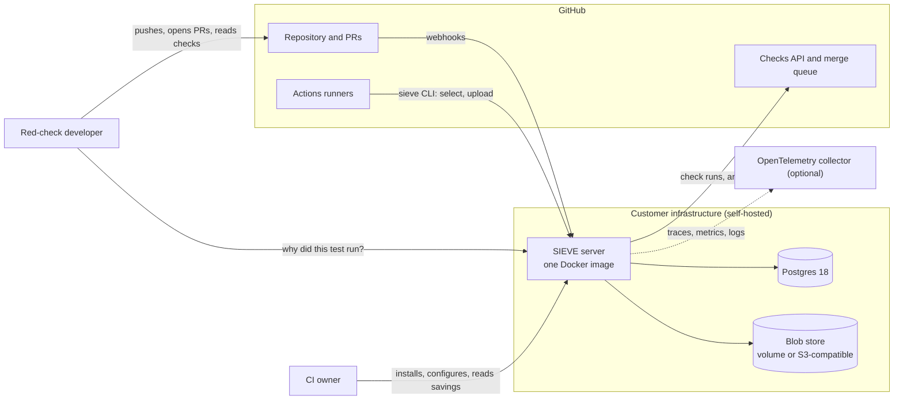
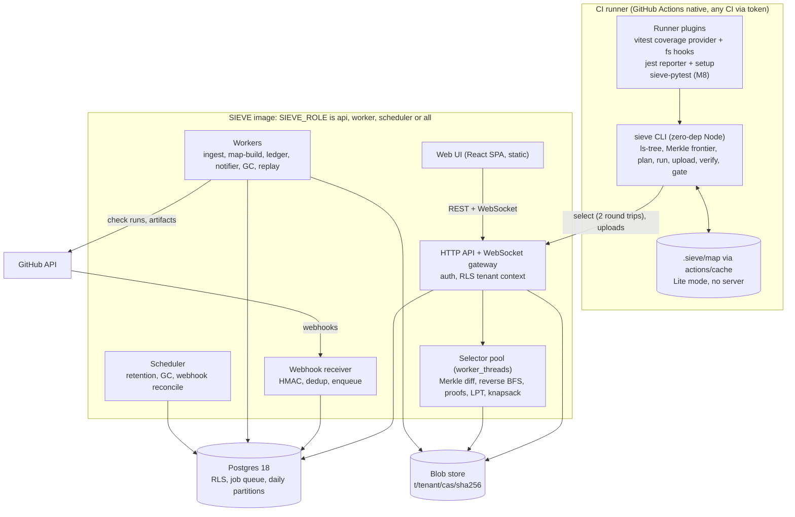
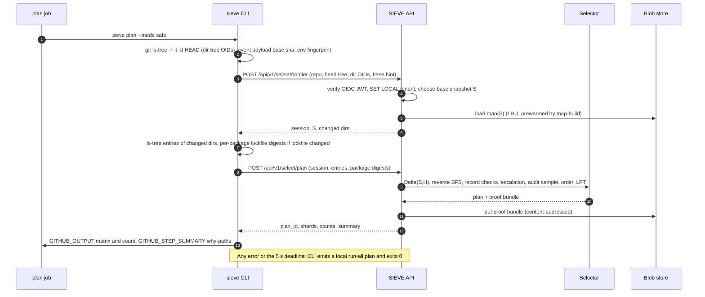
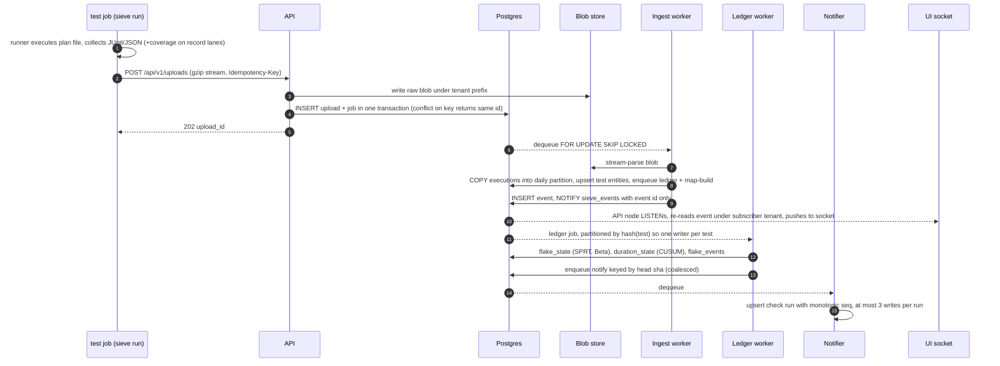
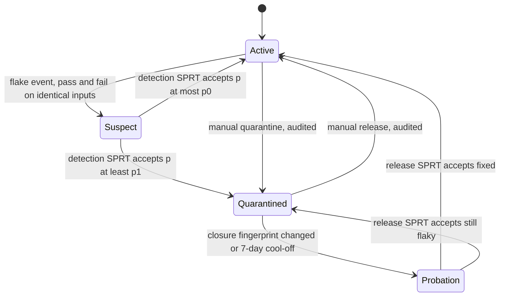
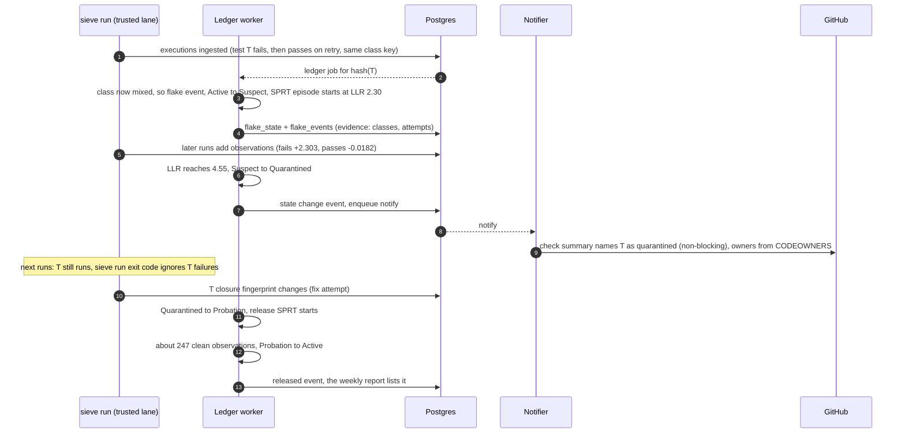
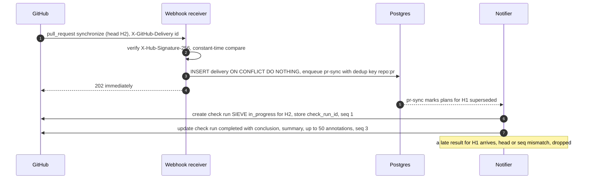
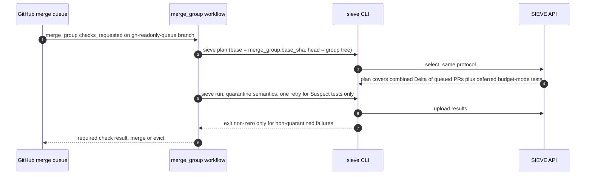
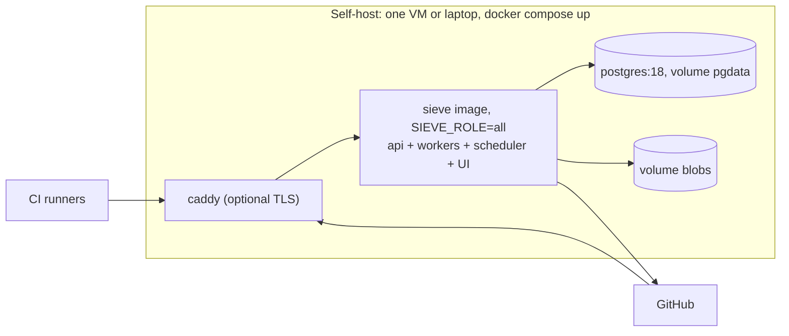
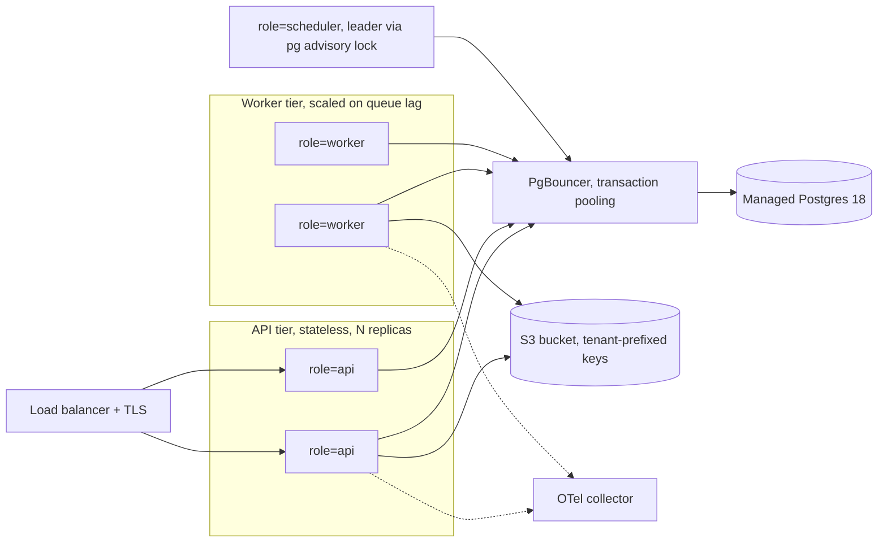

# SIEVE architecture

- **Status:** approved 2026-11-11 in the planning session. It is a living document: decisions change through new ADRs in [adr/](adr/README.md).
- **Companion documents:**
  - [threat-model.md](threat-model.md): security model and adversarial review;
  - [roadmap.md](roadmap.md): milestones and the first two weeks;
  - [adr/](adr/README.md): decision records;
  - [../bench/TARGETS.md](../bench/TARGETS.md): pre-registered targets;
  - [research/RESEARCH_REPORT.md](research/RESEARCH_REPORT.md): the study that chose SIEVE.

---

## 0. Context

**Why SIEVE.** The 2026-11-04 study ranked SIEVE first (42/50): a self-hostable CI test-intelligence service. It answers three questions on every CI run: which tests can this change affect, which failures are flaky, and how much did skipping save (with a measured escape rate)? Pain evidence: rerun culture and 15–20% false failures (A1); naive selection missing regressions (A2); test-to-code maps stuck on laptops and broken by `--depth 1` clones (A3); about a 1% miss tolerance (A4); agent-driven PR volume making CI the bottleneck (A5). Incumbents are SaaS-only or gated (Datadog, Trunk on-prem private preview, Develocity), and the OSS tools are local-first (testmon).

**Decisions made in the planning session (2026-11-11)**
| Topic | Decision |
|---|---|
| Hosting | Self-host first. Multi-tenancy (RLS) is built and fuzzed from day 1. An invite-only hosted beta for public repos opens around launch. |
| Merge gate | After launch. v1 speeds up GitHub's native merge queue (`merge_group` runs, flake-tolerant results). SIEVE's own batching/bisection queue is the first post-launch milestone. |
| License | Apache-2.0 everywhere. |
| Forges | GitHub is the only native integration in v1. Any other CI uses the generic CLI plus an API token, without native statuses or comments. |
| Runners | Vitest and Jest get selection. Playwright gets results, flake ledger and quarantine only. pytest selection comes late (M8). Go comes after launch. |
| Sequencing | Selection engine first (graph, snapshots, coverage, selector) and the kill test early; ingest and UI after. |
| Pace | 6 months at about 25 commits/week. Start Mon 2026-11-16; launch (Show HN) around 2027-05-16. |

**What the research changed in the starting hypothesis**
1. **The safety criterion is content-addressed closure equality, not a commit diff.** A test is skipped only if every node it depends on has the same content hash as in a trusted passing record (Ekstazi-style, extended). Soundness then no longer depends on which base commit is chosen; the base affects only precision. Rebases, force-pushes, merge commits and shallow clones are handled by construction.
2. **Dynamic capture is the backbone. The static graph is one of three sources, not the source.** Static analysis covers what runtime capture cannot see: transform-time inputs in the Vite server process, cold start before any record exists, and the UI explorer.
3. **GitHub now caps history at 90 days.** From 2026-10-01, checks, workflow runs and statuses follow the Actions retention setting: default 90 days, maximum 90 for public repos. So the replay corpus is **re-executed** at historical commits, and an artifact collector starts in week 1.
4. **The baselines got stronger.** Vitest 5.1 shipped `experimental.recordDependencies` (local dynamic module records). Datadog TIA already skips when "covered + tracked files" match a passing run, and any tracked-file change runs everything. SIEVE's edge narrows to: self-hosting, CI-shareable content-addressed maps, non-code inputs at per-package and per-directory precision instead of "run all", proofs, and flake detection without reruns.
5. **Merge queue availability is limited.** It works only on org-owned public repos and Enterprise Cloud private repos, so dogfooding needs a GitHub org. MinIO is in maintenance and archived, so the compose file ships no MinIO. coverage.py's `sysmon` core cannot record per-test contexts. 59% of Python flaky tests are order-dependent (FlaPy). GitHub limits content-creating requests to 500 per hour. Sources are in §9.
6. **SIEVE does not depend on TokenDamper.** The research report presents TokenDamper reuse as a strength. Planning found the only real head start is a lexer worth porting, and even that is optional (§3.2).

**Glossary.**
- **Snapshot** `S`: a repo tree OID plus an environment fingerprint.
- **Node**: a hashed input (file, directory listing, external package, glob, env var, absent file).
- **Closure** `C(t)`: the nodes test `t` depends on.
- **Δ(S,H)**: the nodes whose hash differs between S and H.
- **Record**: a trusted passing execution of `t` with its recorded dependencies.
- **Map** `M_S`: the graph plus valid records at S.
- **Lane**: the trust class of a run.
- **Proof**: a machine-checkable reason for a skip.
- **Escalation level** L0–L3: how far selection widens under uncertainty.

---

## 1. v1 product definition

### 1.1 Personas
| Persona | Situation | What they need from SIEVE |
|---|---|---|
| **Red-check developer** (primary; wedge d) | IC on a 5–200-person team, 15–60 min suite, reruns until green (A1) | In the PR: "is this failure mine or a known flake?" and "why did or didn't this test run?" in one click |
| **CI owner / platform engineer** (installer) | Owns CI cost and speed; regulated, air-gapped or SaaS-averse; cannot ship test telemetry out | Self-host in under 15 min, a risk-free rollout (shadow mode), minutes saved with a bounded escape rate, and CI that never blocks if SIEVE is down |
| **Agent-heavy team lead** (2026 tailwind, A5 and Anthropic's post) | PR volume multiplied by coding agents; CI queue is the bottleneck | Per-PR selection, flake-tolerant merge queue runs, burst handling |
| **OSS maintainer** (beta) | Public repo, fork PRs with no secrets | Selection and flake data that cannot be poisoned by fork PRs |

### 1.2 Top user journeys
1. **First install (target ≤15 min to first map).**
   - Run `docker compose up` (one SIEVE image plus Postgres 18), open the UI, create the org.
   - Install the GitHub App through the manifest flow, then pick repos.
   - `sieve init` in the repo detects Vitest or Jest and the workspaces, and writes `sieve.config.json` plus the workflow (plan → matrix → gate).
   - The first push to the default branch runs a recorded full suite, and the map becomes ready.
   - Before the server exists (M1–M4), the same journey works in **Lite mode**: CLI only, map stored with `actions/cache`.
2. **First selection (PR).**
   - The `plan` job (≤5 s p95) emits shard matrix → test shards run only selected files → the `sieve-gate` job is the single required check.
   - The check run reads "Ran 238 / 1,420 test files (83% skipped; 0 escapes in 1,104 audited skips)".
   - It lists affected tests with **why-paths** (`src/auth/token.ts → src/auth/index.ts → test/login.test.ts`), the skipped count, and a `sieve verify` command.
   - New installs start in **shadow mode**: SIEVE computes skips but runs everything, and reports would-be escapes.
3. **First quarantine.**
   - A test fails and passes on identical inputs, so its state goes Active → Suspect.
   - SPRT accepts "flaky", so the state becomes Quarantined. The check shows "1 quarantined failure (non-blocking)" with the evidence, for example: "failed 3, passed 41 on identical inputs; estimated 6.8% (90% CI 2.4–14%)".
   - The test keeps running. Its failures don't fail builds, and it is released after a probation SPRT.
4. **Weekly savings report.** A UI page plus a markdown digest in the job summary and an optional issue. It shows:
   - test-minutes run vs skipped, and PR CI time p50/p95;
   - the **escape-rate upper bound** (Clopper–Pearson 95%, from audit sampling and nightly runs);
   - quarantines entered and released, the top flaky tests, and duration regressions (CUSUM).
5. **Merge queue (v1).** `merge_group` runs use selection over the combined queued change. Quarantined failures don't evict PRs; Suspect-state failures get one bounded retry.

### 1.3 v1 scope (launch at M10)
- GitHub App and Action; generic CLI for any CI.
- Vitest and Jest selection with recording.
- Playwright and any JUnit producer: results, flake ledger, quarantine.
- pytest selection (M8).
- Safe, shadow and budget modes; proofs and `sieve verify`; audit sampling; nightly escape measurement.
- Flake ledger (SPRT plus decayed Beta) with quarantine; CUSUM duration alarms; LPT sharding.
- Self-host compose (single image); optional Helm; hosted invite-only beta.
- Real-time UI: live run view, impact explorer, proofs, flake heatmap, savings ledger.

### 1.4 Explicit non-goals (v1)
- SIEVE's own merge queue (post-launch M12).
- Native GitLab or Forgejo integration (post-launch).
- Go, Java and C++ selection (post-launch; C++ via the SeamCraft adapter).
- Playwright/e2e selection.
- Vulnerability or reachability scanning (scope guard from the research report).
- LLM features of any kind.
- Generic CI or build analytics dashboards.
- Coverage reporting as a product.
- Automatic test fixing.
- ML or predictive models in the safe-mode skip decision.

**Anti-goals** (failure even if it "works"):
- a skip without a checkable proof;
- SIEVE downtime failing a CI run;
- an unmapped input silently dropped instead of flagged;
- any cross-tenant read;
- "safety" achieved by blanket retries.

---

## 2. Architecture

### 2.1 System context


### 2.2 Containers


**Responsibilities.**
- **The Action/CLI is the data plane.** It plans, runs and uploads, and it writes `$GITHUB_OUTPUT` and the job summary at zero API cost. It never needs the App.
- **The App is the control plane.** It handles webhooks, the canonical "SIEVE" check run, artifact pull-ingest for fork PRs, and merge-queue bookkeeping.
- **Workers communicate only through Postgres.** That means jobs plus an events outbox. No worker holds authoritative state in memory, which is the lesson of Anthropic's 2026-09-14 post, where single-writer in-memory history fell over at 25× CI growth.

### 2.3 Sequence: selection (PR or push)


### 2.4 Sequence: result ingest (append-only journal, then roll-up)


### 2.5 Quarantine lifecycle



### 2.6 Sequence: PR check update (idempotent, out-of-order safe)


### 2.7 Sequence: merge queue run (v1)


### 2.8 Deployment topologies
Self-host:

Hosted multi-tenant:

Notes:
- API nodes keep one *direct* (unpooled) connection for `LISTEN`.
- `SET LOCAL` tenant context is transaction-scoped, so it is safe under transaction pooling.
- Self-host runs the same image with every role in one process. Postgres is the only required dependency.

### 2.9 Ops and packaging
- **Image.** Multi-arch (amd64/arm64), Node 26 LTS (supported until 2029-04-30), non-root.
- **Configuration.** Environment variables plus an optional JSON file; secrets come from files or env.
- **Migrations.** They run on start under `pg_advisory_lock`, with expand/contract style for zero-downtime hosted upgrades. Server and CLI protocols stay compatible N/N−1.
- **Backups.**
  - `pg_dump` plus the blob volume.
  - Maps and rollups can be rebuilt from records.
  - Raw uploads are 14-day caches.
  - The documented RPO equals the Postgres backup interval.
- **Telemetry.** Opt-in and off by default: version, repo-count bucket, test-count bucket, never content. The payload is documented.

---

## 3. Algorithm specifications

Each spec covers input, output, algorithm, complexity, the safety or correctness argument, and failure modes.

### 3.1 Snapshot hashing and Merkle diff
- **Node kinds (v1, file-level).**
  - `f:path`: hash = git blob OID (from `git ls-tree -r -z`; `git hash-object` for declared untracked files). An **absent** file is a node with hash ⊥.
  - `d:dir`: hash = SHA-256 of the sorted entry *names* (catches resolution shadowing and `readdir`).
  - `p:eco:location`: an external package. Hash = the lockfile's integrity/version for that install location (npm `packages["node_modules/x"]`, pnpm `name@version(peer)`, yarn berry descriptor).
  - `g:glob@base`: hash of the sorted matched paths (`import.meta.glob`, declared globs).
  - `e:name`: an env component (OS/arch, runtime major.minor, declared env vars, matrix cell, TZ/locale).
  - `sm:path`: submodule gitlink, hash = commit OID.
- **Snapshot** = (repo, root tree OID, env fingerprint). Git's tree objects *are* the Merkle tree: equal tree OIDs prove equal subtrees, and they are available in `--depth 1` clones.
- **Diff protocol (2 round trips).**
  1. The CLI sends the root tree plus every directory's tree OID (`git ls-tree -r -t -d`; about 60 KB for 10k files).
  2. The server compares them against base snapshot S and returns the changed or new directories.
  3. The CLI sends the direct entries of the changed directories only.
  4. The server derives the file Δ (added, modified, deleted, absent→present) and the dir-listing Δ. The CLI adds per-package digests only if the lockfile node changed, plus env components.
- **Complexity.** O(#dirs + Σ entries(changed dirs)) instead of O(#files). The CLI-side `ls-tree` cost is measured in M1 (expected around 100 ms at 10k files).
- **Correctness.** If a file changes, every ancestor directory's tree OID changes, so descending through changed directories finds every changed file. An absent→present node shows up because its parent's listing changed. P10 (§7.1) checks descent against a naive set diff.
- **Failure modes and handling.**
  - SHA-1 vs SHA-256 repos: object-format detection; node kinds are tagged by algorithm.
  - Dirty tree or generated files: hashed by the CLI only if declared; otherwise the dependent test is unprovable and runs.
  - LFS: the pointer blob changes with the content, which is sufficient.
  - Symlinks: the blob holds the target, and recorded reads map to both paths.

### 3.2 Union impact graph construction
- **Input.**
  - Snapshot listing.
  - Static extraction results.
  - Recorded dynamic dependencies from trusted runs.
  - Declared config.
  - Runner-reported resolution config (Vite `resolve.alias`, Jest `moduleNameMapper`), exported by the plugin at record time so the static resolver never evaluates config JavaScript.
- **Output.** G_S = (V, E) in CSR form with forward and reverse adjacency. Each edge carries a provenance bitmask: static, dynamic, declared.
- **Static edges (CLI, zero-dep lexers).**
  - Import extraction covers `import`/`export … from`, `import()`, `require`, side-effect imports, `import.meta.glob` (→ `g:` node) and `?raw`/`?url` assets. It uses a hand-written state-machine lexer that tracks strings, template literals (with an interpolation stack), regex vs division, and comments.
  - *Optional head start.* TokenDamper's `src/core/validation/ast/ts-validator.ts` and `python-validator.ts` implement this kind of state machine, and `src/core/elision/regions.ts` finds function-body spans (§3.11). Porting them is optional and saves an estimated 3–5 days in M1. Every TokenDamper commit is Ojas's, so the code can be relicensed to Apache-2.0.
  - Resolver:
    - relative imports, extension order, index files;
    - tsconfig `paths`/`baseUrl`/`extends`;
    - package.json `exports`/`imports` with conditions;
    - npm/yarn/pnpm workspaces;
    - **probe recording**: every candidate path tried becomes a ⊥ node, and every probed directory a `d:` node.
  - Unresolvable specifier → `u:` node, which flags the importer as uncertain.
  - `import type` edges are dropped unless the project runs type tests (Vitest typecheck), because that syntax is always erased.
  - Static extraction is cached by (blob OID, extractor version), so a record run re-parses only changed blobs.
- **Dynamic edges (runner plugins, record lanes only).**
  - Test file → every script it executed: V8 function coverage via the Vitest custom provider (`onAfterSuiteRun` fires per test file with `testFiles`), or Jest's per-file `TestResult.v8Coverage`.
  - fs reads, `exists` misses (→ ⊥ nodes) and `readdir` (→ `d:` nodes), from hooks installed in the worker.
  - node_modules paths map to `p:` nodes.
- **Declared edges (config).**
  - `global` inputs: runner config and its imports, setup files, `.env*`, root `package.json`.
  - `declared` match→affects rules.
  - `generated` output→inputs rules.
- **Granularity: file-level** ([ADR-0003](adr/0003-file-level-graph-granularity.md)). Barrels are correct at file level, because ESM evaluates every re-exported module and so they are real runtime dependencies, but imprecise. The symbol-level refinement (§3.11) is the measured lever.
- **Complexity.**
  - Extraction is one linear pass over the bytes; throughput is measured in M1.
  - Resolution is O(imports × probes), cached per (importer dir, specifier, config hash).
  - Target: 10k-file repo cold in under 30 s (goal under 10 s), incremental in under 3 s.
- **Failure modes and handling.**
  - Config the lexer can't evaluate: the plugin exports the runner's effective aliases.
  - Dynamic `import(expr)` with a non-literal: L1 escalation for that package unless dynamic records cover the test.
  - Subprocesses and workers: Vitest's `autoAttachSubprocess` where available, otherwise the test is flagged unprovable.

### 3.3 Selection — safe mode, and the precise definition of a safe skip
**Definitions.**
- `M_S` is *valid* for test t when t has a trusted passing record R and, for every node n ∈ C(t), `hash_S(n) = hash_R(n)`. Here C(t) = forward static closure at S ∪ dynamic deps of R ∪ declared deps.
- **Safe skip of t at H:** M_S is valid for t, the env components are equal, t is not in the audit sample, and C(t) ∩ Δ(S,H) = ∅.

**Assumptions.**
- A1, determinism: the outcome is a function of the contents of the inputs read plus the environment.
- A2, capture completeness: the union closure contains every input read.

**Theorem.** Under A1 and A2, a safe skip of t at H has the same outcome as R (pass).

**Proof sketch.**
1. Execution at H matches R step by step until it reads an input whose content differs.
2. Every input read lies in C(t) by A2, and is unchanged between R, S and H.
3. A different input could only be read after an earlier divergence, which is impossible by induction.
4. Absent files and directory listings are inputs too, which is why they are nodes. ∎

**Corollary (base independence).** The proof never uses ancestry between S and H. Any base with a valid map is sound; an older base only enlarges Δ, which affects precision.

**Algorithm.**
1. Compute Δ (§3.1).
2. Seed escalations (§3.5).
3. Run a multi-source reverse BFS over E from Δ ∪ seeds. A visited bitset and parent pointers give why-paths. Affected A = reached test nodes.
4. Mark tests at H that are new, have no valid record (never passed, failing, env mismatch, untrusted-only, stale) or are on `alwaysRun` as run.
5. Pick an audit sample: rate r (default 2%) of the would-skip set, seeded by run id so it is reproducible.
6. Skip set K = the rest, each with a proof.

**Ordering.** Run order is the ratio rule p_i/w_i descending, which minimises the expected time to the first failure. Exchange argument: putting i first is better iff p_i·w_j > p_j·w_i.

**Quarantined tests.** If affected, they run in a non-blocking lane. If unaffected, they are skipped like any other test.

**Complexity.** O(|Δ| + reached edges) per plan, worst case O(V+E). At 100k nodes and 1M edges that is tens of milliseconds in a worker thread. Map decode is cached per (tenant, repo, map root).

**Map freshness without full runs.**
- Records are facts about closure *contents*, not commits.
- The map-build job for S reuses any trusted passing record whose closure hashes match S.
- Main pushes run only affected tests, with recording on, which refreshes exactly the stale records.
- A nightly full recorded run catches stragglers and measures escapes.

**Failure modes.** See the adversarial table in [threat-model.md](threat-model.md) §2.1. A violation found by audit or nightly triggers an incident:
- the test becomes "unprovable" for 14 days;
- the proof is preserved;
- skips for the owning package pause until the incident is closed.

### 3.4 Budget mode (opt-in)
- **Input:** affected run set A, safety set F (changed test files, new tests, known-failing, `alwaysRun`, audit sample), budget B (test-seconds), and per-test p_i, w_i.
- **Output:** chosen set plus a **deferred set**. Deferred tests are never dropped: they run in the `merge_group` run, the post-merge push, or nightly. The PR check labels them.
- **Objective:** maximise P(detect ≥1 failure) = 1 − Π(1−p_i). Under independence this is exactly additive with value v_i = −ln(1−p_i). Constraint: Σ w_i ≤ B − w(F).
- **Solver:**
  - exact bitset DP when n·W ≤ 2·10⁷ (W = B in 1 s units; for example n = 2,000 and W = 600 gives 1.2M cells);
  - otherwise greedy by density plus a best-single-item guard (½-approximation).
- **Estimating p_i (deterministic, explainable, never used by safe mode).** A fixed logistic score, logit p = β₀ + Σ βₖfₖ, over Beta-smoothed history counts:
  - f1: failure rate when affected;
  - f2: max co-failure rate P(t fails | c changed) over changed c in C(t);
  - f3: 1/(1+BFS depth);
  - f4: log fraction of C(t) changed;
  - flaky failures are excluded.
  - The β values are fitted once on the replay corpus and shipped as versioned constants, so the same history always gives the same p.
  - The UI shows per-feature contributions, for example "+1.4: failed 3 of the last 9 times `src/auth/token.ts` changed".
  - Calibration is reported as a Brier score and a reliability diagram on held-out replay data.

### 3.5 Uncertainty escalation (uncertainty means run)
| Cause | Level | Effect |
|---|---|---|
| Unresolved import, or non-literal `import()` in a changed file without dynamic coverage | L1 | Run all tests of the owning workspace package |
| Changed file not in V(G_S), not ignorable (default ignorable: `**/*.md`, `docs/**`, `LICENSE*`), unknown kind | L1 | Owning package |
| Untracked dynamic dependency with no `generated` rule, or a subprocess or worker not captured | test | That test always runs, and `sieve doctor` suggests a rule |
| Runner config, global setup, `.env*` (global nodes) | L2 | All tests of that runner project (falls out of global edges) |
| Lockfile changed but unparseable or of unknown format | L3 | Everything that reaches any `p:` node (≈ all) |
| Missing or invalid map, schema or engine mismatch, map older than the configured horizon | L3 | Run all |

Every escalation appears in the plan summary with its cause. L0 is file-precise.

### 3.6 Flake ledger and quarantine
- **Identical inputs (equivalence class).**
  - v1: (test case id, tree OID, env fingerprint).
  - v2 (M7, once maps exist): (test case id, **closure fingerprint** = SHA-256 of the sorted (node, hash) pairs of C(test file), env fingerprint).
  - v2 turns runs of the same test across many commits into identical-input evidence. That is flake detection *without reruns*. A divergence there means either a flake or incomplete capture, and both mean "don't trust skips for this test".
- **Observations.**
  - Each attempt (in-run retries included) in a class that contains at least one pass counts as x=1 for a fail and x=0 for a pass.
  - A failure in a class with no pass yet is *pending*: it is ambiguous and could be a real break. It counts as x=1 if a pass later appears in that class.
  - Job-level cancellations and timeouts are excluded.
  - Only **trusted-lane** observations update shared state (anti-poisoning, [threat-model.md](threat-model.md) §1.3).
- **Estimation: decayed Beta-Binomial.**
  - Prior Beta(0.5, 50).
  - On each observation at time t, decay (α−α₀, β−β₀) by 2^(−Δt/14d), then add x or 1−x. O(1) per observation.
  - The UI shows the posterior mean and a 90% credible interval.
- **Detection: Wald SPRT, one fresh test per Suspect episode,** so Wald's bounds hold per decision.
  - Hypotheses: H₀ p = p₀ = 0.002 (noise floor) vs H₁ p = p₁ = 0.02. α = 0.01 (false quarantine), β = 0.05 (missed flake).
  - Thresholds A = ln(0.95/0.01) ≈ 4.55 and B = ln(0.05/0.99) ≈ −2.99.
  - Increments: fail +ln10 ≈ 2.303; pass ln(0.98/0.998) ≈ −0.0182.
  - Starting from the triggering flake (2.30), the test is quarantined at a 2nd flaky fail within about 3 executions, or a 3rd within about 130. It clears after about 291 clean passes.
  - Expected sample numbers: about 148 observations under H₁ and about 215 under H₀. Same order of magnitude as FlaPy's estimate that about 170 reruns are needed for 95% confidence.
- **Release.** Probation starts when the closure fingerprint changes (a fix attempt) or after a 7-day cool-off. A separate release SPRT tests "still flaky" (p₁) vs "fixed" (p₀) with α′ = 0.01 (false release) and β′ = 0.10. Release needs about 247 clean observations, and one flaky failure sends the test back. This asymmetry is the hysteresis.
- **Parameters.** Defaults are per repo and configurable. They are validated by simulation (P9) and against rerun ground truth (target precision ≥ 0.9).
- **Quarantine UX: the test still runs but cannot fail the build.**
  - `sieve run` computes the effective exit code: non-zero only for non-quarantined failures or a runner crash. The raw exit code is preserved in the report.
  - The check shows quarantined failures as non-blocking, with evidence: the classes with mixed outcomes and the LLR trace against A/B.
  - Optional strict mode skips quarantined tests entirely (off by default).
  - CODEOWNERS owners are named in the summary; issue creation is optional.
  - Tests quarantined for more than 30 days are flagged "chronic".
  - Manual overrides are audited.
- **Failure modes.**
  - Infra noise inflating p: p₀ is the floor, and job-level failures are excluded.
  - Order-dependent tests: selection-induced failures are tagged OD, not flaky (§3.12).
  - A capture bug looks like flakiness: v2 classes surface it as a "capture divergence" incident, not a quarantine.

### 3.7 Duration regressions (CUSUM)
- **Input:** per (test, runner class), x_t = ln(duration). Baseline μ₀ and σ₀ = median and 1.4826·MAD over the last 50 runs, winsorized at 4σ.
- **Detector:** one-sided upper CUSUM on z_t = (x_t−μ₀)/σ₀: C_t = max(0, C_{t−1} + z_t − k), with k = 0.5 and h = 5. In-control ARL is about 465 runs and the 1σ-shift ARL about 10.4 (sources in §9).
- **Alarm:** requires C_t > h **and** a post-change median ≥ 1.2× the baseline.
- **Change point** τ̂ = the last t with C_t = 0. Attribution names the commits and PRs between τ̂ and the alarm. The baseline is reset after an alarm.
- **Outputs:** alarms in the UI and weekly report, and refreshed p90 weights for the knapsack and LPT (EWMA in log space).
- **Complexity:** O(1) per execution.

### 3.8 Shard planning (LPT)
- **Input:** run set, w_i = p90 duration estimate, per-shard overhead o (measured job start plus install), and m or a target wall-clock T.
- **Algorithm:**
  - sort by w descending and assign each test to the least-loaded shard (min-heap), O(n log n);
  - Graham's bound: makespan ≤ (4/3 − 1/(3m))·OPT;
  - auto-m picks the smallest m ≤ m_max whose LPT makespan + o ≤ T.
  - GitHub caps a matrix at 256 jobs; the practical default is m_max = 16.
- **Determinism:** ties are broken by test id, so plans are stable across reruns.
- **The UI compares** planned vs actual shard lanes, a Gantt chart streamed over WebSocket.

### 3.9 Proof objects
- **Format.** Canonical JSON (sorted keys), ed25519-signed by the server (node:crypto). It names: the head (tree OID, env fingerprint); the base snapshot and map root; the record (run, commit, outcome = pass, lane, env); the closure (node count, SHA-256 digest, source counts by provenance); the Δ digest; the claim `closure ∩ delta = ∅`; the engine version; the config hash.
- **`sieve verify <proof|plan>`.** Fetches the closure node list by digest. Recomputes head hashes from the local checkout (`ls-tree`, lockfile parse, env). Checks base hashes against the map, checks the claim, checks that the record exists and its lane, and checks the signature. A third party with repo and map access can recheck any skip.
- **Cost.** Verifying one proof is O(|C(t)|) hash lookups plus one signature check. A whole plan is verified in one pass over the union of closures.
- **Failure modes.** Map GC'd before verification (prevented by keeping proofs and their snapshots for 90 days); signing key rotation (the key id is carried in the proof, and old public keys stay published).
- **Why-run explanations.** BFS parent pointers give the shortest path from a changed node to each affected test (static, dynamic or declared hop types). This is the impact explorer's core datum.

### 3.10 Escape-rate measurement
- **Escape:** a skipped t ∈ K_r that would have failed non-flakily at H_r.
- **Shadow mode (before enforcement):** everything runs, so escapes are observed exactly. Enforcement requires 4 consecutive weeks with zero shadow escapes on the repo.
- **Audit sampling (enforced):** a uniform sample of skips is run. The escape-rate estimate gets a Clopper–Pearson 95% upper bound (with 0 failures in n samples, about 3/n). The savings ledger plots this bound.
- **Nightly full recorded runs:** a test that fails on main but was skipped in a merged PR is attributed to the PR whose Δ intersects its closure. If none intersects, it is a capture bug and opens an incident.
- **Reported metrics:**
  - **change-level miss rate**: faulty changes with no failing test selected ÷ faulty changes. This is the target metric, matching A4's "1% chance of missing a failure".
  - **test-level recall**: failing tests selected ÷ failing tests. Facebook PTS reports both kinds of number.
  - **savings**: Σ skipped w ÷ Σ all w per run (median), plus CI wall-clock p50/p95.

### 3.11 Symbol-level refinement (measured lever, not in v1 by default)
- **Mechanism.**
  - Split each file node into `skeleton(f)` (file minus function bodies) plus `body(f, fn)`. Spans come from a function-body scanner built on the import lexer's state machine.
  - Dynamic edges point to the skeletons of evaluated modules and to the bodies of *executed* functions. V8 function ranges are remapped through source maps.
  - A change confined to the bodies of unexecuted functions does not affect a test. Barrels stop blowing up closures.
- **Soundness.** Module evaluation only defines the function objects; an unexecuted body cannot influence the test, except through `fn.toString()`/`length`, which are flagged by a lexer rule.
- **Gate.** Built only if the M4 replay shows file-level barrel blowup costs ≥10 points of savings. In that case it swaps with M8 (pytest) per the contingency in [roadmap.md](roadmap.md).

### 3.12 Order dependence and runner isolation
- **JS.** The selection unit is the test file, which preserves intra-file order. Vitest's defaults (`pool: forks`, `isolate: true`) and Jest's per-file module registry isolate files. A config with `isolate: false` gets a warning, and the affected worker group is treated as one unit.
- **Python (M8).** FlaPy found 59% of Python flaky tests are order-dependent. So pytest selection works at module level and preserves collection order. A test that passed in the full run but fails in a subset at the same fingerprint is tagged order-dependent, and its module always runs whole.

---

## 4. Data model

### 4.1 Postgres 18 (shared schema; every tenant table has `tenant_id uuid not null` plus RLS; ids are `uuidv7()`, built into PG 18)
| Table | Key / partitioning | Purpose and notes |
|---|---|---|
| `tenants`, `users`, `identities`, `memberships` | PK id; memberships (tenant_id, user_id) | Orgs, GitHub identities, roles (owner/admin/member/viewer) |
| `routing_installations` (no RLS, router role only) | `installation_id` unique | Global installation id → tenant. Kept apart because global uniqueness would otherwise be a cross-tenant covert channel |
| `repositories` | unique (tenant_id, forge, forge_repo_id) | Immutable forge ids; rename and transfer handled by webhook |
| `api_tokens`, `oidc_trust` | — | Token SHA-256 hash plus prefix; OIDC claim rules (repository_id, ref, event) |
| `commits` | PK (tenant_id, repo_id, sha) | tree_oid, parents, `first_parent_seq` for the default branch (base choice) |
| `snapshots` | unique (repo_id, tree_oid, env_fp) | lane, `map_root`, map_status |
| `test_entities` | unique (repo_id, runner, project, stable_key) | kind file or case; parent; rename links (same normalized body hash ⇒ same test, IDoFT's MovedOrRenamed rule) |
| `ci_runs` | unique (repo_id, forge_run_id, attempt, job) | event, head/base, PR, lane, mode |
| `plans` | PK id | Summary jsonb plus `proof_bundle` CAS key. Only run, defer and audit items go in `plan_items`; skips stay in the bundle |
| `uploads` | unique (tenant_id, idempotency_key) | kind, blob key, sha256, status |
| `test_executions` | **RANGE by `executed_on` (daily)**; hosted adds HASH(tenant_id) sub-partitions | outcome, attempt, duration, `class_key` (equivalence class), shard. BRIN(executed_at), btree (tenant_id, test_id, executed_at desc). **Retention 30 days by dropping partitions** |
| `test_daily_rollups` | PK (tenant_id, test_id, day) | runs, fails, flaky_fails, skips, p50/p90, total ms. Kept 400 days |
| `flake_state` | PK (tenant_id, test_id) | FSM state, Beta (a, b, updated_at), SPRT (llr, n, episode, started_at), evidence |
| `flake_events`, `duration_state`, `duration_alarms` | — | Timeline, CUSUM state, alarms with change-point commits |
| `escapes` | — | detected_by (shadow, audit, nightly), proof ref, status |
| `savings_daily` | PK (tenant_id, repo_id, day) | Total vs skipped test-seconds, audited, audit_failures |
| `jobs` | partial unique index on `dedup_key` WHERE pending | kind, payload, run_at, attempts, `vt` (virtual time), locked_until |
| `webhook_deliveries` | PK delivery_id | Dedup plus reconcile |
| `forge_checks` | unique (repo_id, head_sha, name) | check_run_id, last seq |
| `events` | bigserial | Outbox for WebSocket fan-out (NOTIFY carries the id only; payload limit 8000 bytes) |
| `cas_objects` | PK (tenant_id, repo_id, hash) | Blob bookkeeping for GC |
| `audit_log` | append-only | Logins, tokens, settings, overrides, exports |

**Queue semantics** ([ADR-0007](adr/0007-postgres-job-queue.md)).
- Delivery is at-least-once: `FOR UPDATE SKIP LOCKED` dequeue, visibility timeout via `locked_until`, and a reaper.
- Every handler is idempotent on natural keys (upload_id, delivery_id, (run, test, attempt)).
- **Supersede:** `INSERT … ON CONFLICT (dedup_key) WHERE pending DO UPDATE SET payload`, so only the latest PR head is processed.
- **Fairness:** stride scheduling, where each enqueue sets vt = max(tenant_vt, global_vt) + cost/weight and dequeue orders by vt.
- **Ledger single writer:** ledger jobs are partitioned by hash(test) so each test has one writer.
- **Lag metric:** "jobs in = jobs out" is tracked as the primary health signal.

### 4.2 Blob store and map format
- **Layout.** `t/{tenant}/r/{repo}/uploads/{id}` (raw, 14-day TTL) and `t/{tenant}/r/{repo}/cas/{sha256}`, holding map chunks, proof bundles and graph segments.
- **Backends.** Local volume (default) or S3-compatible. **No cross-tenant dedup** (prevents confirmation-of-file probing).
- **SMAP v1 format** ([ADR-0009](adr/0009-smap-binary-map-format.md)). Custom little-endian binary, encodable and decodable with zero dependencies via `DataView`. Sections:
  - header (magic, version, hash algorithm);
  - a front-coded sorted path string table;
  - a node table (kind, path id, hash);
  - forward and reverse CSR adjacency with delta-varint offsets and targets;
  - a 2-bit provenance per edge;
  - a test table (record ref, env fingerprint, closure digest).
- **Chunking.** Maps are chunked per workspace package and content-addressed; the map root is the Merkle root of the chunk hashes. Unchanged packages reuse their chunks across snapshots.
- **Hashing** ([ADR-0010](adr/0010-hashing.md)). Git's object hash for file contents. SHA-256 (node:crypto) for everything SIEVE computes: digests, fingerprints, CAS keys.
- **GC.** Per-repo mark-and-sweep.
  - Roots: the latest K = 5 snapshots per live branch (seen in the last 30 days and not deleted), snapshots referenced by plans within proof retention (90 days), and pinned benchmark snapshots.
  - Two-phase: objects unmarked for 24 h become candidates and are deleted in the next cycle, so in-flight uploads are never raced.
  - Work is bounded per repo.

### 4.3 Retention summary
| Data | Default (self-host configurable) |
|---|---|
| Raw uploads | 14 days |
| Executions | 30 days (daily partitions) |
| Rollups, flake and duration state, savings | 400 days |
| Plans and proof bundles | 90 days (the window in which proofs can be verified) |
| Maps | GC'd by reachability |
| Audit log | 400 days |

---

## 5. Interfaces

### 5.1 CLI (`sieve`; zero runtime dependencies; Node `>=22`, tested on 22, 24 and 26; npm scope TBD because `sieve` is taken)
Node 20 reached end of life on 2026-04-30, and Node 22 does on 2027-04-30, so the floor rises to Node 24 at launch ([release schedule](https://github.com/nodejs/Release)).
| Command | Purpose |
|---|---|
| `sieve init` | Detect runners and workspaces; write `sieve.config.json` and the workflow (plan → matrix → gate) |
| `sieve record -- <cmd>` | Recorded run (plugins inject coverage and fs hooks); upload results plus dynamic deps plus graph segments (trusted lanes) |
| `sieve plan [--mode safe\|shadow\|budget] [--budget 10m] [--shards auto\|N] [--map dir]` | Compute selection. Writes `$GITHUB_OUTPUT` (plan_id, matrix, count) and the job summary. `--map` = Lite mode, fully local |
| `sieve run [--shard k] -- <cmd>` | Run the shard's exact file list (plan file read by the runner plugin, no CLI filters); apply quarantine exit semantics; upload, or spool `sieve-results.tgz` |
| `sieve gate` | The single required check: aggregates `needs` results and the plan; fails only on real failures |
| `sieve upload <files…>` | Results-only ingest (Playwright, any JUnit) |
| `sieve verify <proof\|plan-id>` · `sieve explain <test>` · `sieve doctor` · `sieve graph\|diff` | Proof check, why-path, environment diagnosis, inspection |

**`sieve.config.json`** (JSON, zero-dep parser; validated by the CLI and the server):
```json
{
  "version": 1,
  "server": "https://sieve.internal.example",
  "projects": [
    { "name": "web", "runner": "vitest", "root": "packages/web", "command": "npx vitest run" },
    { "name": "api", "runner": "jest", "root": "packages/api", "command": "npx jest" },
    { "name": "e2e", "runner": "playwright", "mode": "results-only" }
  ],
  "inputs": {
    "global": ["package.json", ".env.test"],
    "declared": [{ "match": "fixtures/payments/**", "affects": "packages/api/test/payments/**" }],
    "generated": [{ "outputs": "packages/web/src/gql/**", "inputs": ["schema.graphql", "codegen.ts"] }],
    "ignore": ["**/*.md", "docs/**"]
  },
  "env": { "track": ["NODE_ENV", "TZ"] },
  "selection": { "mode": "shadow", "auditRate": 0.02, "alwaysRun": [], "trustPullRequestsFrom": "writers" },
  "quarantine": { "enabled": true, "strict": false, "sprt": { "p0": 0.002, "p1": 0.02, "alpha": 0.01, "beta": 0.05 } },
  "sharding": { "max": 16, "targetMinutes": 10 }
}
```

### 5.2 CLI ↔ server API v1
Versioning:
- path `/api/v1` plus a `Sieve-Protocol: 1` header with capability negotiation;
- the server supports N and N−1, and an unknown version returns 426, which the CLI treats as run-all.

| Method and path | Purpose | Auth |
|---|---|---|
| `POST /api/v1/select/frontier` | Round 1: dir tree OIDs, base hint, env → session, base S, changed dirs | OIDC JWT (aud bound) or repo token; anonymous read-only for opted-in public repos |
| `POST /api/v1/select/plan` | Round 2: entries of changed dirs, package digests → plan_id, shards, counts | same |
| `GET /api/v1/plans/{id}/shards/{k}` · `GET /api/v1/plans/{id}/proofs?test=` | Shard file list · proofs | same |
| `POST /api/v1/uploads` | Streaming gzip; `Idempotency-Key` = run+attempt+job+shard+part; 202 | OIDC or token (never anonymous) |
| `POST /api/v1/runs/{id}/complete` | Totals, status | same |
| `GET /api/v1/…` (UI) · `WS /api/v1/stream` | UI REST; subscriptions to run, plan and repo topics | Session cookie, CSRF |

**Degraded mode (never block CI).**
- Deadlines: connect 1 s, select 5 s total, configurable.
- Any timeout, 5xx, 503 with Retry-After, auth error or protocol mismatch makes the CLI emit a run-all plan: an equal split, or LPT if cached durations exist. It then annotates "SIEVE unavailable: ran all tests" and exits 0.
- Uploads run in the background, capped at 30 s at job end, then spool to an artifact for later pull-ingest.
- `--strict` is the only mode in which SIEVE errors fail the job.

### 5.3 GitHub integration (the clean-skip pattern for `actions/runner#662`)
```yaml
on: [pull_request, push, merge_group]          # merge_group must trigger required checks
jobs:
  plan:
    runs-on: ubuntu-latest
    permissions: { id-token: write, contents: read }
    outputs: { matrix: "${{ steps.sieve.outputs.matrix }}", count: "${{ steps.sieve.outputs.count }}" }
    steps:
      - uses: actions/checkout@<current major>   # depth 1 is fine
      - id: sieve
        run: npx @sieve-ci/cli plan            # placeholder package name
  test:
    needs: plan
    if: needs.plan.outputs.count != '0'
    strategy: { matrix: "${{ fromJSON(needs.plan.outputs.matrix) }}" }
    runs-on: ubuntu-latest
    steps:
      - uses: actions/checkout@<current major>
      - run: npx @sieve-ci/cli run --shard ${{ matrix.shard }} -- npx vitest run
  sieve-gate:                                   # the ONLY required check
    needs: [plan, test]
    if: always()
    runs-on: ubuntu-latest
    steps:
      - run: npx @sieve-ci/cli gate --needs '${{ toJSON(needs) }}'
```
**Why this shape** ([ADR-0013](adr/0013-github-integration-pattern.md)).
- A job skipped by `if` reports **Success** and does not block required checks. A zero-test plan is therefore clean.
- The `if: always()` gate guarantees a failing shard fails the required check.
- No early-exit hacks are needed.
- `pull_request` checks out the merge commit `refs/pull/N/merge`. SIEVE hashes the tree actually tested, and takes `pull_request.base.sha` from `$GITHUB_EVENT_PATH` as the base hint, with no API call.

**GitHub App.**
- **Permissions** (to confirm against the permissions reference in M6): Checks write; Actions read (artifacts for fork pull-ingest); Contents read; Metadata read; Pull requests write (only for the optional sticky comment).
- **Events and handling:**

| Event | Handling |
|---|---|
| `installation`, `installation_repositories` | Routing table and repo registry |
| `push` | Default branch: first-parent chain, schedule map-build |
| `pull_request` (opened, synchronize, closed) | Supersede old plans, lane from `author_association` |
| `check_suite` / `check_run` rerequested | Re-plan |
| `workflow_run` completed | Pull-ingest fork-PR artifacts into the untrusted lane |
| `merge_group` | Bookkeeping |
| `repository` renamed/transferred | Transfer to another account **detaches** the repo from the tenant |

- **Receiver rules:**
  - HMAC-SHA256 `X-Hub-Signature-256`, constant-time compare;
  - dedup on `X-GitHub-Delivery`;
  - acknowledge fast and enqueue;
  - out-of-order: drop events for superseded heads, and never move a check from completed back to in_progress (monotonic seq);
  - a reconciler job re-requests failed deliveries via the App deliveries API (endpoint to verify in M6).
- **Rate-limit design:**
  - Installation tokens: 5,000 req/h (+50 per repo and per user above 20, cap 12,500; 15,000 on Enterprise Cloud).
  - Secondary limits: 80 content-creating requests/min and 500/h.
  - Therefore: **≤3 writes per run** (create, final update, optional comment), coalesced per head SHA. Details go to job summaries, which cost nothing.

**Check run format.**
- Name "SIEVE".
- Title "Ran 238 of 1,420 test files · 83% skipped · 0 escapes in 1,104 audits".
- Summary (≤65,535 chars):
  - mode badge;
  - new failures;
  - quarantined (non-blocking) failures with evidence;
  - affected tests with why-paths (top 20);
  - skipped count with a `sieve verify --plan <id>` line;
  - escalations with causes;
  - duration alarms.
- Annotations: failing test locations, ≤50 per request.
- Conclusion: success / failure / neutral (shadow and degraded informational).

**PR comment (optional, off by default).** One sticky comment, found by the marker `<!-- sieve:pr -->` and edited in place, so a run never adds a second comment. It holds:
- a 3-line verdict (new failures, quarantined failures, skipped with escape bound);
- up to 5 why-paths;
- links to the check run and the UI plan page.
It counts toward the ≤3 writes per run.

### 5.4 Lite mode (no server; M3)
- The default branch runs `sieve record`, then `actions/cache/save` with key `sieve-map-${{ github.sha }}`.
- PRs run `actions/cache/restore` with `restore-keys: sieve-map-`, then `sieve plan --map .sieve/map`. The diff, BFS and proofs all happen locally.
- No flake ledger in Lite mode. Branch-scoping rules for the cache are to be verified in M3 (§8.3). See [ADR-0021](adr/0021-lite-mode-actions-cache.md).

---

## 6. Security model (summary)

The full model and the adversarial review are in [threat-model.md](threat-model.md). In short:
- **Tenancy:** shared schema with Postgres RLS (`ENABLE` + `FORCE`), transaction-scoped `SET LOCAL` tenant context, tenant-scoped uniqueness, and an isolation fuzzer and lint in CI.
- **CI auth:** GitHub Actions OIDC JWTs first, hashed repo tokens second.
- **Trust lanes:** fork-PR records never become evidence for anyone else, which blocks map and ledger poisoning.
- **Privacy:** source code never leaves the runner. There is an optional strict mode that hashes paths and test names.

---

## 7. Verification strategy

### 7.1 Property-based and differential tests (fast-check as a devDependency; seeded and deterministic)
- **P1 soundness:** a random DAG + closures + Δ always selects every test whose closure intersects Δ.
- **P2 base independence:** any valid base selects a superset of the truly affected tests.
- **P3 monotonicity:** Δ₁ ⊆ Δ₂ ⇒ A₁ ⊆ A₂.
- **P4 proof validity:** every emitted proof passes an **independent naive verifier** (forward DFS per test; no shared code).
- **P5 escalation:** any non-ignorable unknown changed node triggers ≥ L1.
- **P6 determinism:** byte-identical canonical plans across runs and OSes.
- **P7 knapsack:** DP equals brute force for n ≤ 15; greedy ≥ ½·OPT; safety set always included; Σw ≤ B.
- **P8 LPT:** for small n, makespan ≤ (4/3 − 1/(3m))·OPT against a brute-force optimum. For any n, makespan ≤ Σw/m + max w (the list-scheduling bound). Ties are deterministic.
- **P9 SPRT:** simulated Bernoulli streams at p₀ and p₁ give an empirical false-quarantine rate ≤ α and missed rate ≤ β (within Monte Carlo error); release SPRT likewise.
- **P10 Merkle:** descent equals a naive listing diff on random trees, including absent→present and renames.
- **P11 ingest:** permuted, duplicated or dropped-then-redelivered uploads and webhooks give an identical final DB state (model-based).

### 7.2 Seeded-fault end-to-end on synthetic repos (`tools/toyrepo`)
A generator produces small TS repos with:
- modules and call chains, barrels, `import.meta.glob`, fixtures read via fs, snapshots;
- env-dependent code, subprocess tests and generated files.

A mutator flips conditionals, constants and calls in changed functions; ground truth is a full run. **Gate: zero unsafe skips over ≥10k mutants** before any release that changes the selector.

### 7.3 Golden graphs, the replay harness and the benchmark protocol
- **Golden graphs.** Pinned commits of 6 OSS TS repos chosen by the corpus criteria, plus SIEVE's own repo once its suite is big enough. Graph statistics and sampled edges are committed; diffs are reviewed like snapshots.
- **Replay harness (`tools/replay`, re-execution because of the 90-day retention).** For each repo, ≥200 historical commits or PRs in a pinned container:
  1. record at c₀;
  2. for each cᵢ, plan against the latest mapped snapshot, then run the full suite as ground truth (failures rerun 3× to separate flaky from real);
  3. seed k mutants into changed functions to multiply faulty changes;
  4. measure savings, change-level miss rate and test-level recall.
- **Baselines:**
  - run-all;
  - `vitest related` (static; dynamic imports not followed);
  - `vitest --changed` with `recordDependencies`;
  - `jest --findRelatedTests`;
  - a filename heuristic;
  - coverage-only plus "tracked files → run all" (Datadog-like);
  - SIEVE static-only, dynamic-only and union.
- **Compute.** Standard GitHub-hosted runners are free for public repos, so replay matrices can run in a public `sieve-replay` repo, within fair use, or locally.
- **Measurement discipline:**
  - frozen corpus manifests (hashes), pinned engine (dist hash, `dirty` flag);
  - refuse to report on a mismatch, an empty sample or an unattributed stage;
  - assert counts;
  - timing is a separate invocation from correctness.
- **Pre-registered targets:** [../bench/TARGETS.md](../bench/TARGETS.md) (T1–T8 and the kill criterion), committed before the first measurement.

### 7.4 Chaos, isolation fuzzing, performance
- **Chaos:** duplicated, dropped, reordered and delayed webhooks; truncated gzip uploads; workers killed mid-job; Postgres restart; full blob disk; clock skew. Check invariants after each scenario (exactly-once effects, monotonic checks, no lost results).
- **Isolation fuzzing:**
  - API level: random requests with tenant A credentials and ids harvested from tenant B, asserting 404 and no B data fingerprints in responses;
  - DB level: every repository function runs under A's context with B's data present;
  - WebSocket subscribe attempts to B's topics;
  - the static RLS lint.
- **Performance:** select latency vs repo size (1k/10k/100k synthetic plus real); graph build; ingest rows/s (streaming parse + COPY); SMAP size and decode; UI frame rate at 10k nodes.

### 7.5 How to verify the first deliverables end to end
1. `npm test` (unit + property + toy-repo seeded faults) is green.
2. `sieve graph` on each golden-graph repo matches its pinned graph.
3. A PR on SIEVE's own repo shows the shadow summary with why-paths, and the gate job is green.
4. Stopping the server (from M5) still gives a green PR with "ran all tests" (degraded mode).
5. The corpus collector's daily run commits new manifests.

---

## 8. Risks, kill criteria, open questions

### 8.1 Risk register (top 10)
| # | Risk | L/I | Mitigation |
|---|---|---|---|
| 1 | Capture incompleteness leads to escapes and lost trust | M/H | Union graph, ⊥ and `d:` nodes, escalation, shadow → audit → nightly, independent verifier, seeded-fault gate, incident freeze |
| 2 | Savings too low: coupled codebases (pytest-tia measured about 21% median skip on Flask vs about 96% on boltons) or barrels | M/H | Symbol-level lever, an "over-connected nodes" report (setup files importing everything), budget mode, M4 kill gate |
| 3 | Stronger free baselines: Vitest `recordDependencies` (5.1), Datadog, Trunk free tier | H/M | Compete on CI-shareable content-addressed maps, non-code input precision, proofs, self-host, flake-without-reruns; publish head-to-head replay numbers |
| 4 | Runner API churn (Vitest 3→5 provider changes; Jest) | M/M | Thin adapters + version-matrix tests; fallback per-process `NODE_V8_COVERAGE` with per-file runs in record mode; decide the supported floor in M2 |
| 5 | Record overhead (V8 precise coverage disables optimized code; no authoritative public overhead figure) | M/M | Record on trusted lanes only; binary function coverage; measured in M2 (T7) |
| 6 | 6-month pace (25 commits/week, December holidays) | H/M | Cut list, weekly milestone burn-down, no buffer assumed |
| 7 | GitHub platform constraints: 90-day retention, secondary write limits, merge queue limited to org or GHEC | H/M | Collector from week 1 plus re-execution replay; ≤3 writes per run; dogfood org |
| 8 | Poisoning or tenant leak in hosted beta | L/H | Lanes, RLS + FORCE, fuzzing, lint, invite-only beta |
| 9 | Python order-dependence (59% of Python flakes) breaks subset determinism | M/M | Module units, OD tagging, Python late |
| 10 | Name collision: npm `sieve` taken; SIEVE (NSDI'24 cache algorithm); RFC 5228 Sieve mail filter | H/L | Keep the codename; pick a final name by M9; scoped packages |

### 8.2 Kill and pivot criteria
- **K1 (M4, Jan 24, 2027):** <30% median savings at ≤1% change-level miss on ≥5 repos → pivot to a flake-ledger-first product.
- **K2:** any shadow or audit escape not root-caused and fixed within 7 days → enforcement frozen (shadow only) until fixed.
- **K3 (M9):** fewer than 2 of 3 non-author users succeed → M10 becomes onboarding work and launch slips.
- **K4:** quarantine precision <0.9 → ship the ledger as advisory, with no automatic quarantine.

### 8.3 Open questions
1. Who the 3 non-author M9 testers are.
2. The final name and npm scope.
3. Whether to move the repo into a GitHub org before M6, since GitHub's merge queue needs an org-owned repo.
4. Minimum Vitest and Jest versions. The provider interface verified in this session is Vitest 5's; whether it holds for Vitest 3 and 4 is unchecked.
5. Measured V8 record overhead, binary vs count mode.
6. The job-outputs size limit (not on the limits page).
7. Primary-source confirmation that OIDC is withheld from fork PRs.
8. Whether `GITHUB_TOKEN` can create check runs for Lite mode.
9. `actions/cache` scoping rules for Lite-mode trust.
10. The exact GitHub App permission set and the deliveries/redelivery endpoints.
11. Trunk Team's effective price (the page still says $0 while the FAQ says paid).
12. IDoFT Python row counts, and the source of JS flake ground truth (likely our own reruns).
13. The hosted-beta provider and budget.

---

## 9. Research spike results (verified 2026-11-11 unless marked)
1. **Per-test coverage.**
   - **V8.**
     - CDP: `takePreciseCoverage` "resets execution counters", and enabling precise coverage "prevents running optimized code" ([v8 js_protocol.pdl](https://raw.githubusercontent.com/v8/v8/main/include/js_protocol.pdl)).
     - The V8 blog gives no overhead numbers ([v8.dev](https://v8.dev/blog/javascript-code-coverage)).
   - **Vitest** (current v5.1.0).
     - `onAfterSuiteRun` is "called with coverage results after a single test file has been run", and its meta includes `testFiles` ([coverage.ts](https://github.com/vitest-dev/vitest/blob/main/packages/vitest/src/node/types/coverage.ts), [general.ts](https://github.com/vitest-dev/vitest/blob/main/packages/vitest/src/types/general.ts)).
     - `autoAttachSubprocess` tracks child_process and worker_threads (v8 provider only).
     - Defaults: pool `forks`, isolate `true` ([pool](https://vitest.dev/config/pool), [isolate](https://vitest.dev/config/isolate)).
     - **`experimental.recordDependencies` (5.1.0):** records modules loaded per test file in local `cacheDir`, uses git or mtime detection, and does **not** record fs reads ([experimental](https://vitest.dev/config/experimental)).
     - `vitest related` is static and does not follow dynamic imports ([CLI](https://vitest.dev/guide/cli)).
   - **Jest:** `TestResult.v8Coverage` and `coverage` are per test file ([types.ts](https://github.com/jestjs/jest/blob/main/packages/jest-test-result/src/types.ts)).
   - **coverage.py.**
     - `dynamic_context = test_function` and pytest-cov `--cov-context` ([contexts](https://coverage.readthedocs.io/en/latest/contexts.html)).
     - The `sysmon` core (default on 3.14) "does not yet support … dynamic contexts" ([config](https://coverage.readthedocs.io/en/latest/config.html)).
     - pytest-tia forces `ctrace` for this reason and tracks non-.py files with `sys.addaudithook('open')` ([pytest-tia](https://github.com/breadMSA/pytest-tia)).
   - **Python `sys.monitoring`:** `DISABLE` per location and `restart_events()`, since 3.12 ([docs](https://docs.python.org/3/library/sys.monitoring.html)).
   - **Go.**
     - `runtime/coverage.ClearCounters` requires atomic mode and `-cover` ([pkg.go.dev](https://pkg.go.dev/runtime/coverage)).
     - Go's test cache matches on files and env consulted, and `go list -json` exposes `TestGoFiles`, `EmbedFiles` and `Deps` ([cmd/go](https://pkg.go.dev/cmd/go)).
     - So Go fits package-level selection, post-launch.
2. **tree-sitter in Node** (measured earlier in TokenDamper, whose source was read in this session):
   - `web-tree-sitter` (WASM), with grammar packages that ship `.wasm` files, works without native builds. Trees must be freed with `tree.delete()` because WASM memory isn't garbage-collected.
   - Initializing the runtime plus 4 grammars costs about 22 ms per process (TokenDamper DECISIONS §81).
   - SIEVE's CLI doesn't need tree-sitter: import extraction uses a hand-written lexer ([ADR-0002](adr/0002-zero-dependency-cli.md)).
3. **GitHub mechanics.**
   - Check conclusions: action_required, cancelled, failure, neutral, success, skipped, stale (GitHub-only), timed_out. 50 annotations per request; 65,535-char summary. Only GitHub Apps can create check runs ([checks/runs](https://docs.github.com/en/rest/checks/runs)).
   - Skipped jobs report Success and don't block required checks ([conditions](https://docs.github.com/en/actions/using-jobs/using-conditions-to-control-job-execution)).
   - Matrix ≤256 jobs; GITHUB_TOKEN 1,000 req/h/repo ([limits](https://docs.github.com/en/actions/reference/limits)).
   - `pull_request` uses the merge ref; forks get read-only tokens and no secrets; `workflow_run` is privileged; `merge_group` is required for queue checks ([events](https://docs.github.com/en/actions/reference/workflows-and-actions/events-that-trigger-workflows)).
   - Merge queue scope: org-owned public repos, or Enterprise Cloud private repos (docs, surfaced via search).
   - Retention: default 90 days; public maximum 90; from 2026-10-01 checks, runs and statuses are included ([changelog](https://github.blog/changelog/2026-08-27-actions-retention-will-cover-checks-workflow-runs-and-statuses)).
   - App rate limits: 5,000/h, cap 12,500, 15,000 on Enterprise Cloud; secondary 80/min and 500/h for content creation ([rate limits](https://docs.github.com/en/rest/using-the-rest-api/rate-limits-for-the-rest-api)).
   - OIDC claims ([OIDC](https://docs.github.com/en/actions/concepts/security/openid-connect)). *That fork PRs get no OIDC token comes from secondary sources only.*
   - Standard runners are free for public repos ([billing](https://docs.github.com/en/billing/managing-billing-for-github-actions/about-billing-for-github-actions)).
4. **Competitors.**
   - **Trunk** (checked 2026-11-11): Team shows $0 while the FAQ says "paid after trial"; on-prem is Enterprise-only and still private preview ([pricing](https://trunk.io/pricing)).
   - **Datadog TIA:**
     - skips when covered + tracked files match a passing run; any tracked-file change runs all;
     - the default branch is excluded automatically; unskippable markers exist;
     - supports .NET, Java, JS, Swift, Python, Ruby and Go ([how it works](https://docs.datadoghq.com/tests/test_impact_analysis/how_it_works/), [overview](https://docs.datadoghq.com/tests/test_impact_analysis/)).
   - **New in 2026:**
     - Vitest `recordDependencies` (above);
     - codebase-memory-mcp "Smart CI": experimental, C/C++ only, local-first, MIT, recommends shadow mode ([repo](https://github.com/DeusData/codebase-memory-mcp));
     - pytest-tia: 34★; Flask median skip about 21%, boltons about 96%;
     - Anthropic's internal service: listener/selector, then journal + roll-up; 25× CI jobs in 6 months ([post](https://claude.com/blog/agentic-coding-is-straining-ci-heres-how-we-scaled-test-impact-analysis-at-anthropic)).
   - HN since 2025-11 shows no new OSS self-hosted selection plus flake product.
5. **Datasets.**
   - **IDoFT:** Java Maven (`pr-data.csv`), Java Gradle (`gr-data.csv`) and **Python (`py-data.csv`)**. Categories: OD (with Brit/Vic), ID, NIO, NOD, NDOD, NDOI, UD, OSD, TD, TZD. Same test body means the same test ([readme](https://github.com/TestingResearchIllinois/idoft)). Row counts not yet extracted.
   - **FlaPy:** 22,352 PyPI projects and 876,186 tests; 7,571 flaky tests in 1,006 projects; 59% order-dependent; about 170 reruns needed for 95% confidence ([arXiv 2101.09077](https://arxiv.org/abs/2101.09077)).
   - **FlakeFlagger** dataset, BSD ([ICSE'21](https://2021.icse-conferences.org/details/icse-2021-papers/115/FlakeFlagger-Predicting-Flakiness-Without-Rerunning-Tests), [zenodo](https://zenodo.org/record/4450723)).
   - **No JS flaky dataset verified**, so JS ground truth comes from our own reruns.
6. **Related work.**
   - Ekstazi (ISSTA'15): 32% average end-to-end time reduction, 54% on longer suites ([abstract](https://users.ece.utexas.edu/~gligoric/papers/abstracts/GligoricETAL15Ekstazi.txt)).
   - Facebook PTS (ICSE-SEIP'19): 2× infra cost reduction, >95% of test failures and >99.9% of faulty changes reported ([arXiv 1810.05286](https://arxiv.org/abs/1810.05286)).
   - Uber SubmitQueue (EuroSys'19, speculation graph) ([Uber](https://www.uber.com/blog/research/keeping-master-green-at-scale)); 2025 follow-up, about 53% CI resource cut ([arXiv 2501.03440](https://arxiv.org/abs/2501.03440)).
   - iDFlakies (ICST'19, cited by IDoFT).
   - Google (2016): about 16% of tests have some flakiness, about 1.5% of runs flaky. *Via secondary sources* ([blog](https://testing.googleblog.com/2016/05/flaky-tests-at-google-and-how-we.html)).
   - STARTS selects more tests than Ekstazi. *Secondary.*
7. **Infrastructure.**
   - graphile-worker: about 15.6k jobs/s unbatched, about 183k batched, i9-14900K ([perf](https://worker.graphile.org/docs/performance)).
   - DuckDB: one read-write process; multiple writers need Quack server mode or DuckLake ([concurrency](https://duckdb.org/docs/2.0/connect/concurrency.html)).
   - ClickHouse's official sizing figure was not retrieved; third parties cite 32 GB. *Unverified.*
   - MinIO: images stopped Oct 2025 and maintenance mode Dec 2025 (multiple secondary sources); archived Feb 2026 (one source).
   - PG 18: `uuidv7()` ([press kit](https://www.postgresql.org/about/press/presskit18)); RLS semantics ([docs](https://www.postgresql.org/docs/current/ddl-rowsecurity.html)); NOTIFY payload <8000 bytes, 8 GB queue ([docs](https://www.postgresql.org/docs/current/sql-notify.html)).
   - CUSUM with k = 0.5: h = 4 gives ARL₀ about 168 and ARL₁ about 8.4; h = 5 gives about 465 and 10.4 ([JMP](https://community.jmp.com/t5/JMPer-Cable/Using-ARL-Average-Run-Length-to-determine-the-performance-of-a/ba-p/61895)).
   - Graphs: Sigma.js v3 stable on npm with a v4 site live; Cytoscape WebGL is still a preview ([sigma](https://www.sigmajs.org), [cytoscape](https://blog.js.cytoscape.org/2025/01/13/webgl-preview/)).
8. **Replay candidates.**
   - Workflows matching `--reporter=junit` plus `upload-artifact` (code search): electron/forge, PostHog/posthog, baserow/baserow, visgl/luma.gl, Significant-Gravitas/AutoGPT (frontend), mariadb-corporation/mariadb-connector-nodejs, meshery/meshery.
   - Python matching `--junitxml` plus `upload-artifact`: Azure/azure-iot-sdk-python, mozilla-conduit/review, NatLabRockies/buildstockbatch, jborean93/ansibug.
   - The re-execution set (≥8, Vitest/Jest-heavy, runnable offline in under 10 min) is vetted in week 1 against the `bench/CORPUS.md` criteria. *Not verified yet.*
9. **Name:**
   - npm `sieve` is taken (Sieve of Eratosthenes, v0.0.4, 2014) ([registry](https://registry.npmjs.org/sieve));
   - SIEVE is an NSDI'24 cache eviction algorithm ([USENIX](https://www.usenix.org/conference/nsdi24/presentation/zhang-yazhuo));
   - RFC 5228 is "Sieve: An Email Filtering Language" (Proposed Standard, 2008) ([RFC](https://www.rfc-editor.org/rfc/rfc5228)).

