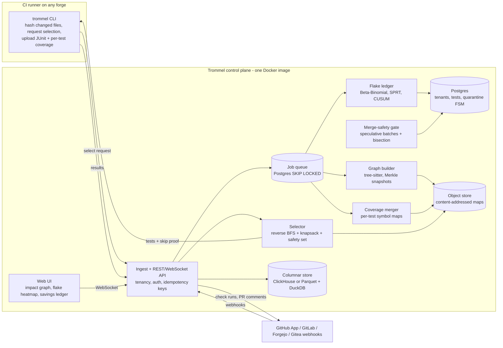
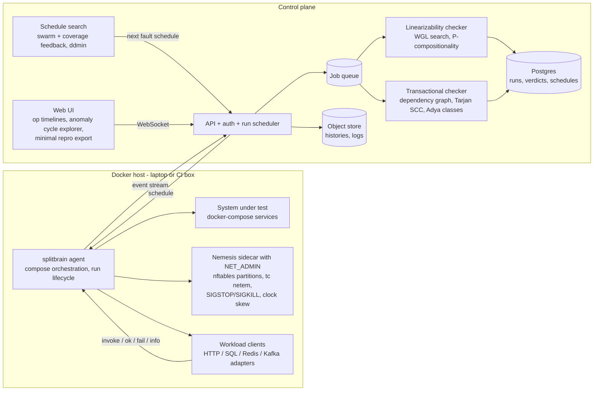
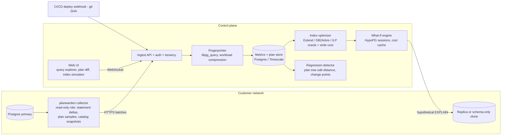
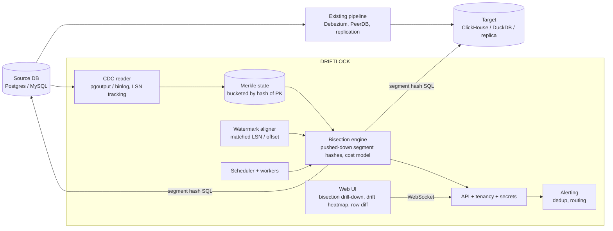

# RESEARCH_REPORT.md — Next Flagship Project (≈600 commits, deployed systems product)

**Prepared for:** Ojas Sugur (GitHub `ojassug`), author of TokenDamper and SeamCraft
**Research date:** 2026-11-04 (all star counts, HN points, and prices are snapshots from this date)
**Status:** Ready for independent audit. Every evidence row carries a URL or item ID.
**Renamed 2026-11-14:** the study called Blueprint #1 by the codename SIEVE. This copy uses the project's final name, Trommel, and changes nothing else ([DECISIONS.md](../../DECISIONS.md) entry 30).

---

## 0. Method, tools, and limits (read first)

| Pass | What was done | Tools actually used |
|---|---|---|
| 1. Pain mining | HN Algolia search + full comment trees; Reddit discovery; GitHub issue search sorted by 👍; vendor pricing pages | HackerNews MCP, Exa MCP, GitHub MCP, WebSearch/WebFetch |
| 2. Algorithm pairing | Mapped each pain point to a CS primitive; rejected primitives that do not change a user-visible outcome | Sequential Thinking MCP (thought 1) |
| 3. 600-commit sizing | Decomposed each candidate into 10 milestones across engine / storage / ingest / tenancy / UI / verification | Sequential Thinking MCP (thought 2) |
| 4. Falsification | Ran three kill tests on all 10 candidates (K1: free/OSS tool already solves the wedge; K2: forced algorithmic core; K3: no solo dogfooding) | Sequential Thinking MCP (thought 3), plus targeted GitHub/vendor checks |

**Tool limits, disclosed:**
- **Firecrawl MCP:** the keyless scrape endpoint refused every request in this session. **No evidence in this report came from Firecrawl.**
- **Exa MCP:** hit its free rate limit once. That query was rerun through WebSearch/WebFetch.
- **Quoting policy:** the report contains exactly **one** verbatim quote (§1). Everything else is a short paraphrase in my own words, next to a permalink or comment ID, so the auditor can check exact wording at the source.

**Corrections made during research:**
1. I first suspected Meta's Hermit (deterministic Linux sandbox) had been archived. GitHub shows it still active (pushed 2026-11-02), so I do **not** use it as evidence of abandonment.
2. Reachability-first dependency scanning started as a likely winner. Late in Pass 4 I found GitHub's 2026-10-28 public preview and Semgrep's free tier, which flipped it to **killed** (§2.1).
3. AWS Performance Insights end-of-life: sources give conflicting dates (2026-06-30 vs 2026-07-31). Both are reported as-is and flagged for the auditor.

---

## 1. Executive Summary & Market Evidence Log

### 1.1 Recommendation

**Build Blueprint #1, Trommel: a self-hostable CI test-intelligence platform.** It has the largest and most recent volume of user pain. AI coding agents are now multiplying PR volume; one 2026 write-up reports that "One engineer with coding agents was enough to make CI a bottleneck" ([dudzik, 2026](https://humansystems.dudzik.co/p/when-agents-make-ci-the-bottleneck)). Trommel also has the tightest Day-1 dogfood loop: install it on TokenDamper's own repo and replay public OSS CI history.

If you would rather optimise for raw systems-engineering growth than near-term users, pick **Blueprint #2, SPLITBRAIN** (Jepsen-grade correctness testing for app teams). It ties Trommel on total score, has the deepest algorithms, and the incumbent (Antithesis) is closed to small teams.

| Rank | Codename | One line | Total score /50 |
|---|---|---|---|
| 1 | **Trommel** | Self-hosted test-impact analysis, flake ledger, and merge-safety gate for any forge or CI | 42 |
| 2 | **SPLITBRAIN** | Fault injection + linearizability/serializability verdicts for docker-compose stacks | 42 |
| 3 | **PLANWARDEN** | Self-hosted Postgres workload advisor: plan-regression tracking + storage-budgeted index selection | 39 |
| 4 | **DRIFTLOCK** | Continuous, CDC-aware cross-database reconciliation via incremental Merkle trees | 36 |

**Killed in Pass 4:** reachability-first dependency scanning, self-hosted Sentry alternative, self-hosted code search, self-hosted on-call, test-data subsetting/anonymization (§2).

### 1.2 Market Evidence Log

Columns: **ID · Source · Date · Hard metric · What it shows (paraphrase) · Supports**

#### A. CI / test pain (supports Trommel)

| ID | Source | Date | Metric | What it shows | Supports |
|---|---|---|---|---|---|
| A1 | [r/devops: Reduce CI CD pipeline time strategies that actually work? Ours is 47 min](https://www.reddit.com/r/devops/comments/1op2qri/reduce_ci_cd_pipeline_time_strategies_that/) | 2025-11-05 | 137 pts, 139 comments | 47-min suite; OP estimates 15–20% of failures are false; devs rerun until green; some bypass CI and push straight to prod | Flake + selection pain at scale |
| A2 | [r/devops: QA tests blocking our CI/CD pipeline 45min per run](https://www.reddit.com/r/devops/comments/1p1uh6c/qa_tests_blocking_our_cicd_pipeline_45min_per_run/) | 2025-11-20 | 9 pts, 44 comments | 5–10 random failures per run; their attempt to run only relevant tests per PR missed regressions | Naive selection is unsafe → need provable selection |
| A3 | [r/devops: Running only the tests a git diff affects in CI — the CI-shareable part is the hard bit](https://www.reddit.com/r/devops/comments/1ubigky/running_only_the_tests_a_git_diff_affects_in_ci/) | 2026-06-21 | — | Most TIA tools keep the test→code map on the developer's laptop. CI needs a shareable map keyed by git ref that still works on `--depth 1` shallow clones | Concrete technical gap Trommel M2 targets |
| A4 | [r/ExperiencedDevs: At what point do you run e2e tests?](https://www.reddit.com/r/ExperiencedDevs/comments/1pza4pr/at_what_point_do_you_run_e2e_tests/) | 2025-12-30 | — | A team runs affected tests on branches and tracks a roughly 1% chance of missing a failure | Sets the ≤1% miss-rate benchmark target |
| A5 | [dudzik: When agents make CI the bottleneck](https://humansystems.dudzik.co/p/when-agents-make-ci-the-bottleneck) | 2026-08 | p95 CI incl. queue ≈7h35m → 35m; selector overhead ≈15 s; Actions spend ≈$10→$50/mo | TypeScript dependency graph + runtime tracing selection; conservative policy that runs tests whenever a change can't be confidently mapped; full suite nightly | Validates hybrid static+dynamic design; 2026 agentic-coding tailwind |
| A6 | [GitHub actions/runner #662](https://github.com/actions/runner/issues/662) — Command to early-exit the job and set check conclusion | open since 2020-08-16 | 930 👍, 69 comments | GitHub Actions still has no native way to end a job early with a chosen conclusion | Skipping tests cleanly needs workarounds Trommel can package |
| A7 | [tarpas/pytest-testmon #177](https://github.com/tarpas/pytest-testmon/issues/177) — How to use in gitlab CI; [#77](https://github.com/tarpas/pytest-testmon/issues/77) — merge testmon databases | open since 2022-02 / 2017-10 | 10 👍 / 0 👍; repo 1,034★ | The leading OSS Python TIA tool is local-first; CI sharing and DB merging have been open for years | OSS gap is structural, not cosmetic |
| A8 | [Datadog pricing](https://www.datadoghq.com/pricing/) (Test Optimization) | checked 2026-11-04 | from $20/committer/mo; committer = 3+ commits/mo; test spans kept 3 months | TIA works by recording which files each test covers. Third-party trackers list $24 month-to-month and $29 on-demand, with no free plan ([testdino](https://testdino.com/blog/currents-vs-datadog), [itechguides](https://www.itechguides.com/products/datadog-test-optimization/)) | Pricing wedge (a); coverage-only design |
| A9 | [Trunk pricing](https://trunk.io/pricing) | checked 2026-11-04 | Free ≤5 committers; Team displayed as $0/committer + $3 per extra 1M spans (FAQ calls Team a paid plan after trial) | Enterprise adds SSO and on-prem/bring-your-own-cloud; the on-prem option is labelled private preview | Strong SaaS competitor; self-host wedge (b) remains |
| A10 | [Develocity Predictive Test Selection](https://develocity.ai/develocity/product/predictive-test-selection/) | checked 2026-11-04 | No prices on page; 30-day trial | Enterprise sales motion | Wedge (a) |
| A11 | GitHub repos: [reportportal/reportportal](https://github.com/reportportal/reportportal) 2,042★ (441 open issues); [sorry-cypress](https://github.com/sorry-cypress/sorry-cypress) 2,812★, last push 2025-09-14 | 2026-11-04 | stars / activity | OSS dashboards report results but don't do safe selection; the Cypress-only one is going stale | No OSS kill for Trommel |

#### B. Distributed-systems correctness (supports SPLITBRAIN)

| ID | Source | Date | Metric | What it shows | Supports |
|---|---|---|---|---|---|
| B1 | [Antithesis pricing](https://antithesis.com/pricing/) | checked 2026-11-04 | No published prices | Demo-only buying path; FAQ says there is no free or open-source tier; deals often go through AWS Marketplace private offers | Wedge (a), enterprise-gated |
| B2 | [HN 39358526](https://news.ycombinator.com/item?id=39358526) (Antithesis co-founder) | 2024-02-13 | — | Small-team pricing and a free tier were on the roadmap; they built single-tenant dedicated hardware first | Gating is structural (cost of infra) |
| B3 | [HN 45257953](https://news.ycombinator.com/item?id=45257953) | 2025-09-16 | — | A commenter criticises opaque pricing and lock-in to the vendor's compute | Persona mismatch (d) |
| B4 | Jepsen analyses on HN: [RDS for PostgreSQL 17.4](https://news.ycombinator.com/item?id=43833195) · [NATS 2.12.1](https://news.ycombinator.com/item?id=46196105) · [ParticleDB 1.1.4](https://news.ycombinator.com/item?id=50316100) · [TigerBeetle](https://news.ycombinator.com/item?id=44199592) | 2025-04 → 2026-10-31 | 608 pts/146 c · 432 pts/165 c · 359 pts/213 c · 241 pts/86 c | Correctness findings get top-of-HN attention every few months | Demand / mindshare |
| B5 | [jepsen-io/jepsen](https://github.com/jepsen-io/jepsen) 7,557★ (Clojure); [maelstrom](https://github.com/jepsen-io/maelstrom) 3,745★; [elle](https://github.com/jepsen-io/elle) 713★; [knossos](https://github.com/jepsen-io/knossos) 427★ | 2026-11-04 | stars | The gold standard is a Clojure framework plus libraries, not a product | Wedge (b)/(d) |
| B6 | [jepsen #129](https://github.com/jepsen-io/jepsen/issues/129) (sample test fails on Ubuntu/LXC, open since 2016-06); [jepsen #568](https://github.com/jepsen-io/jepsen/issues/568) (Docker clock changes break tests, open since 2023-03) | — | low 👍 | Environment setup has been a known friction point for years | Packaging is the wedge |
| B7 | [HN 42357968](https://news.ycombinator.com/item?id=42357968) | 2024-12-08 | — | A commenter argues learning Clojure beats waiting for a Jepsen alternative, implying none exists | No productized alternative |
| B8 | [Shopify/toxiproxy](https://github.com/Shopify/toxiproxy) 12,483★; [porcupine](https://github.com/anishathalye/porcupine) 1,274★ | 2026-11-04 | stars | Fault injection and checking exist as separate tools; nothing joins them | Integration wedge |
| B9 | OSS DST platforms: [bloodhound](https://github.com/nerdsane/bloodhound) 25★, [chronos](https://github.com/sx4im/chronos) 19★, [anysystem](https://github.com/osukhoroslov/anysystem) 16★, [gosim](https://github.com/neria-cloud/gosim) 4★, [faultline](https://github.com/hmdsefi/faultline) 4★ | 2026-11-04 | stars | Many attempts, none with traction | Space is open; interest exists |
| B10 | [antithesishq org](https://github.com/antithesishq) — top repo [bombadil](https://github.com/antithesishq/bombadil) 1,578★ (property-based testing for web/terminal UIs) | 2026-11-04 | — | Antithesis open-sources SDKs and adjacent tools, not its fault+checker core | Not a kill |
| B11 | [ardentperf: Run Jepsen against CloudNativePG](https://ardentperf.com/2025/09/01/run-jepsen-against-cloudnativepg-to-see-sync-replication-prevent-data-loss/) | 2025-09-01 | 22 failing iterations of 93 in a 12-hour run | Random fault schedules find real data loss only intermittently | Benchmark baseline for guided search |
| B12 | [Jepsen: PostgreSQL 12.3](https://jepsen.io/analyses/postgresql-12.3) | — | — | Elle found a G2-item anomaly under SERIALIZABLE | Regression-corpus target |
| B13 | [aphyr: Jepsen — final thoughts](https://aphyr.com/posts/286-jepsen-final-thoughts) | 2013-05-20 | — | Kingsbury advises teams to run a client that records API responses, inject failures, then compare the log with final state | This is literally SPLITBRAIN's product loop |

#### C. Postgres workload tooling (supports PLANWARDEN)

| ID | Source | Date | Metric | What it shows | Supports |
|---|---|---|---|---|---|
| C1 | [pganalyze pricing](https://pganalyze.com/pricing) | checked 2026-11-04 | Production $149/mo (1 server, Index Advisor); Scale $399/mo (≤4 servers, +$100/server); Enterprise = contact sales | On-prem / own-cloud deployment is Enterprise-only | Wedge (a) |
| C2 | [HN 49163658](https://news.ycombinator.com/item?id=49163658) (pganalyze CEO) | 2026-08-04 | 500+ customers, bootstrapped, profitable | The paying market is real | Demand |
| C3 | [r/rails: How are you monitoring Postgres query performance in production?](https://www.reddit.com/r/rails/comments/1rqsuo3/how_are_you_monitoring_postgres_query_performance/) | 2026-03-11 | 13 pts, 11 comments | OP outgrew PgHero, can't explain post-deploy slowdowns, finds $149/mo steep; a reply calls Datadog DBM good but expensive for small teams | Persona + regression-after-deploy feature |
| C4 | [r/selfhosted: Postgres observability when self-hosting](https://www.reddit.com/r/selfhosted/comments/1u2h34t/postgres_observability_when_selfhosting/) (later removed by a mod) | 2026-06-10 | — | Hetzner + Coolify user couldn't get pgwatch running under docker-compose | Wedge (b), packaging friction |
| C5 | AWS docs: [Overview of Database Insights on RDS](https://docs.aws.amazon.com/AmazonRDS/latest/UserGuide/USER_PerfInsights.Overview.html); [DoiT transition guide](https://www.doit.com/blog/transitioning-from-rds-performance-insights-to-cloudwatch-database-insights) | 2026 | EOL moved from 2025-11-30 to 2026-06-30 per DoiT; some AWS pages surfaced by search say 2026-07-31 | Performance Insights console replaced by CloudWatch Database Insights. DoiT says execution-plan capture, previously free, now needs the paid Advanced tier | Pricing pressure on AWS users |
| C6 | [ankane/dexter](https://github.com/ankane/dexter) 2,096★; [issue #6](https://github.com/ankane/dexter/issues/6), handling write-heavy tables | open since 2017-07-10 | — | The best-known OSS auto-indexer still doesn't model write cost | Structural gap PLANWARDEN fills |
| C7 | [supabase/index_advisor](https://github.com/supabase/index_advisor) 1,709★; [powa-web](https://github.com/powa-team/powa-web) 84★ | 2026-11-04 | — | OSS advisors work per query, or have little adoption | Not a kill |
| C8 | New entrants: [RDST on r/PostgreSQL](https://www.reddit.com/r/PostgreSQL/comments/1vnmm5h/i_built_a_free_tool_that_does_the_pg_stat/) (desktop app, 19 pts); [OptiSchema Slim on r/selfhosted](https://www.reddit.com/r/selfhosted/comments/1ps30q6/open_source_i_built_a_doctor_for_postgres_not/) (HypoPG + local LLM); [DeepSQL Show HN](https://news.ycombinator.com/item?id=48980286) (self-hostable DBA agent) | 2025-12 → 2026-08 | — | Lots of activity, much of it LLM-driven | Crowding risk; deterministic wedge (c) |
| C9 | [hyrise/index_selection_evaluation](https://github.com/hyrise/index_selection_evaluation) (MIT) | — | implements 8 algorithms | Includes Extend (ICDE 2019), DB2Advis-like, AutoAdmin-like, Relaxation, CoPhy, Dexter, Drop, Anytime | Ready-made benchmark baseline |
| C10 | [gregrahn/join-order-benchmark](https://github.com/gregrahn/join-order-benchmark) 378★ | — | — | Standard JOB (IMDB) workload | Benchmark corpus |

#### D. Data reconciliation (supports DRIFTLOCK)

| ID | Source | Date | Metric | What it shows | Supports |
|---|---|---|---|---|---|
| D1 | [datafold/data-diff](https://github.com/datafold/data-diff) | archived; last push 2024-05-17 | 2,988★ | The default OSS cross-DB diff tool was abandoned in favour of the paid platform | Wedge (a) |
| D2 | [erezsh/reladiff](https://github.com/erezsh/reladiff) | last push 2025-08-18 | 547★ | Maintained fork by the original author; a one-off CLI | Doesn't do continuous checks |
| D3 | [r/dataengineering: Tool as a data-diff alternative?](https://www.reddit.com/r/dataengineering/comments/1cyn2a6/tool_as_a_datadiff_alternative/) | 2024-05-23 | — | User left stranded by data-diff's sunset | Displaced users |
| D4 | [r/dataengineering: Recommendation for comparing two synced data sources?](https://www.reddit.com/r/dataengineering/comments/1l7nomj/recommendation_for_comparing_two_synced_data/) | 2025-06-10 | — | Needs ongoing reconciliation, not a one-time migration check; replies point to ML observability vendors and Datafold | Wedges (a) + (c) |
| D5 | [r/dataengineering: Datafold — I am seeking insights from real users](https://www.reddit.com/r/dataengineering/comments/1jwn3gu/datafold_i_am_seeking_insights_from_real_users/) | 2025-04-11 | — | SQL Server→Snowflake migration diffs exposed case-sensitivity, whitespace and date-function mismatches | Canonicalization is core |
| D6 | [dataworkers.io: Data Diff Tools in 2026](https://dataworkers.io/resources/data-diff-tools-2026/) | 2026-06-10 | — | Confirms data-diff archived; reladiff recommended for one-off cross-DB checks; dbt/SQLMesh/Recce cover in-warehouse PR review | Landscape map |
| D7 | [DBLog, arXiv 2010.12597](https://arxiv.org/abs/2010.12597) | 2020 | — | Watermark technique merges table snapshots with the change log without locks | Algorithmic basis for lag-free comparison |

#### E. Evidence behind the killed ideas (§2)

| ID | Source | Date | Metric | What it shows |
|---|---|---|---|---|
| E1 | [HN: Turn Dependabot off](https://news.ycombinator.com/item?id=47094192) (words.filippo.io) | 2026-02-20 | 647 pts, 185 comments | Commenters ask for a govulncheck equivalent in npm/Python ([47094742](https://news.ycombinator.com/item?id=47094742), [47094817](https://news.ycombinator.com/item?id=47094817)); one argues call-path checking should be the default everywhere ([47095265](https://news.ycombinator.com/item?id=47095265)) |
| E2 | [HN: Reducing Dependabot Noise](https://news.ycombinator.com/item?id=46583914) | 2026-01-12 | 64 pts, 44 comments | Alert fatigue is mainstream |
| E3 | [r/cybersecurity: reachability analysis to cut through vulnerability noise](https://www.reddit.com/r/cybersecurity/comments/1kr2epr/anyone_using_reachability_analysis_to_cut_through/) | 2025-05-20 | — | One reply reports 60–70% of CVEs dropping once call paths are mapped |
| E4 | [GitHub changelog 2026-10-28: Dependabot reachability](https://github.blog/changelog/2026-10-28-prioritize-dependabot-alerts-with-reachability-analysis/); [docs](https://docs.github.com/en/code-security/concepts/supply-chain-security/about-reachability-analysis-for-dependabot-alerts) | 2026-10-28 | free public preview | GitHub Enterprise Cloud only; JS/TS only; GitHub-hosted runners only; roughly daily scans, not triggered by pushes |
| E5 | [Semgrep pricing](https://semgrep.dev/pricing) | checked 2026-11-04 | Free ≤10 contributors incl. Supply Chain reachability; Teams $30/contributor/mo | Small teams already get reachability free |
| E6 | [Socket pricing](https://socket.dev/pricing); [Socket reachability docs](https://docs.socket.dev/docs/reachability-analysis) | checked 2026-11-04 | Team $25/dev/mo includes precomputed reachability | Full-application function-level reachability and self-hosted SCMs are Enterprise-only |
| E7 | [cs-au-dk/jelly](https://github.com/cs-au-dk/jelly) 449★; [osv-scanner #2540: Python reachability](https://github.com/google/osv-scanner/issues/2540) (open) | 2026 | — | JS research analyzer exists; Python remains open |
| E8 | [HN: I gave up on self-hosted Sentry (2024)](https://news.ycombinator.com/item?id=43725815) | 2025-04-18 | 186 pts, 150 comments | Self-hosted Sentry is seen as heavy (16 GB minimum complaint at [43726295](https://news.ycombinator.com/item?id=43726295)); GlitchTip and HyperDX named as lighter options |
| E9 | [bugsink/bugsink](https://github.com/bugsink/bugsink) 2,159★ (source-available; GitHub's license field reads Other) | pushed 2026-11-01 | — | Active self-hosted error tracker |
| E10 | [HN: Sourcegraph went dark](https://news.ycombinator.com/item?id=41296481); [Show HN: Sourcebot](https://news.ycombinator.com/item?id=41711032) | 2024-08 / 2024-10 | 424 pts/182 c; 259 pts/59 c | Demand appeared, and Sourcebot filled it |
| E11 | [sourcebot-dev/sourcebot](https://github.com/sourcebot-dev/sourcebot) 4,018★, MIT (tagged fair-source) | pushed 2026-10-31 | — | Active self-hosted code search |
| E12 | [Atlassian Opsgenie licensing](https://www.atlassian.com/licensing/opsgenie) | 2025-03-04 announcement | end of sale 2025-06-04; end of support 2027-04-05 | Displaced on-call users |
| E13 | [Grafana OnCall OSS maintenance mode](https://grafana.com/blog/grafana-oncall-maintenance-mode/); [docs notice](https://grafana.com/docs/oncall/latest/set-up/open-source/) | 2025-03-11 → archived 2026-03-24 | — | SMS/phone/push relied on a Grafana Cloud relay that was switched off |
| E14 | [HN: Atlassian announces end of support for Opsgenie](https://news.ycombinator.com/item?id=43283178); [HN: What do people use for on-call these days?](https://news.ycombinator.com/item?id=44009101) | 2025-03 / 2025-05 | 95 pts/104 c; 8 pts/10 c | Small teams want cheap, minimal, reliable paging ([43285105](https://news.ycombinator.com/item?id=43285105)); a commenter rejects AI-driven alert silencing ([43285057](https://news.ycombinator.com/item?id=43285057)) |
| E15 | [target/goalert](https://github.com/target/goalert) 2,863★, Apache-2.0 | pushed 2026-11-02 | — | Active OSS on-call scheduling and escalation |
| E16 | [GreenmaskIO/greenmask](https://github.com/GreenmaskIO/greenmask) 1,800★, Apache-2.0; [subset docs](https://www.greenmask.io/docs/greenmask/database_subset) | pushed 2026-10-29 | — | Docs: subsetting resolves circular references with recursive queries and supports virtual (non-FK) references. A Greenmask blog post surfaced by search adds multi-cycle handling within one strongly connected component and polymorphic refs |
| E17 | [nucleuscloud/neosync](https://github.com/nucleuscloud/neosync) archived (4,128★); [Qovery/Replibyte](https://github.com/Qovery/Replibyte) last push 2025-08-08 (4,419★) | — | — | Earlier OSS players abandoned; Greenmask fills the gap |

---

## 2. The Killed Ideas Graveyard (falsification proof)

Kill tests: **K1** a free/OSS tool already solves the exact wedge cleanly · **K2** the algorithmic core is forced · **K3** no realistic solo validation.

### 2.1 Reachability-first dependency scanning (a govulncheck for npm/PyPI) — KILLED by K1 (wedge closing)
- **Why it looked great:** the strongest single pain signal in the whole study (E1: 647-pt HN thread with repeated npm/Python requests; E3). Perfect TokenDamper continuity: tree-sitter call graphs, BFS reachability, Myers diff over fix commits to extract vulnerable symbols.
- **What killed it:** three funded incumbents moved into exactly this wedge within about 18 months:
  - [Semgrep Free](https://semgrep.dev/pricing) includes Supply Chain reachability for up to 10 contributors.
  - [GitHub Dependabot reachability](https://github.blog/changelog/2026-10-28-prioritize-dependabot-alerts-with-reachability-analysis/) launched 2026-10-28 as a free preview (Enterprise Cloud, JS/TS).
  - [Socket Team](https://socket.dev/pricing) at $25/dev/mo includes precomputed reachability.
  - Go already has govulncheck.
- **Residual niche:** Python precision ([osv-scanner #2540](https://github.com/google/osv-scanner/issues/2540)), non-GitHub forges, PR-time checks. These are narrow and research-hard. Building into a wedge that GitHub ships natively a week before you start is a losing product bet, however good the engineering.

### 2.2 Lightweight self-hosted Sentry alternative — KILLED by K1
- **Pain is real:** E8 (186 pts; 16 GB minimum complaint).
- **Killer:** [Bugsink](https://github.com/bugsink/bugsink) (2,159★, active, self-host-first; its own blog post *is* the HN thread) plus [GlitchTip](https://glitchtip.com/), which commenters name in E8.
- **Secondary K2:** the algorithmic core (stack-trace fingerprinting and grouping) is thin compared with the infrastructure work.

### 2.3 Self-hosted code search & navigation — KILLED by K1
- **Pain was real:** E10 (Sourcegraph's repo went private in 2024: 424 pts).
- **Killer:** [Sourcebot](https://github.com/sourcebot-dev/sourcebot) (4,018★, MIT, active, launched explicitly as an OSS Sourcegraph alternative).
- **Lesson:** the trigram-index / regex-planning core is excellent CS, but the wedge was filled within two months of opening.

### 2.4 Self-hosted on-call & paging with a constraint-solver rota — KILLED by K1 + K2 + K3
- **Displacement is real:** Opsgenie EOL (E12), Grafana OnCall OSS archived (E13).
- **K1:** [GoAlert](https://github.com/target/goalert) (2,863★, Apache-2.0, pushed 2026-11-02) already covers self-hosted schedules and escalation. New entrants keep appearing ([IncidentRelay](https://github.com/roxy-wi/IncidentRelay), 225★).
- **K2:** users asked for simple, reliable, cheap paging (E14), not optimal rotas. A CSP scheduler would be decoration.
- **K3:** the genuinely hard part is carrier-grade SMS/voice/push delivery. Grafana OnCall OSS depended on a cloud relay for exactly this (E13). That is telecom ops, not something a solo dev can dogfood.

### 2.5 Test-data subsetting & deterministic anonymization — KILLED by K1
- **Market churn is real:** Neosync archived, Replibyte stale (E17).
- **Killer:** [Greenmask](https://github.com/GreenmaskIO/greenmask) (1,800★, Apache-2.0, active). It already ships FK-graph subsetting with circular-reference handling (recursive queries; multi-cycle SCC handling per its blog), virtual and polymorphic references, and masking/anonymization transformers (E16). Those were the exact algorithms that would have justified the project.

### Screened, not pursued
Visual regression testing: [Argos](https://github.com/argos-ci/argos) (MIT, active) and commercial Chromatic/Percy/Happo crowd it. [Lost Pixel](https://github.com/lost-pixel/lost-pixel) being archived (1,676★) suggests weak OSS economics. The SeamCraft image-diff tie-in was attractive, but the moat is thin.

---

## 3. Top 4 Flagship Blueprints (ranked)

> Codenames are placeholders. Check npm, GitHub, and trademark collisions before any public launch.

---

### Blueprint #1 — Trommel

**Pitch:** A self-hostable test-intelligence service that tells every CI run which tests it can safely skip, which failures are flaky, and *why*. Works on any forge, and each skip comes with a machine-checkable safety argument.

#### Underserved wedge & target user
- **Who is hurting:** teams of 5–200 engineers with 15–60 minute suites, where flaky failures have created a rerun culture (A1, A2). Teams whose PR volume has exploded because of coding agents (A5). Teams on GitLab CE, Forgejo/Gitea, Jenkins, or Buildkite, and regulated or air-gapped orgs that can't ship test telemetry to a SaaS.
- **Incumbents and their gaps:**

| Incumbent | Price / gate | Why it fails this user |
|---|---|---|
| [Datadog Test Optimization](https://www.datadoghq.com/pricing/) | $20–29/committer/mo, no free plan (A8) | Pricing-hostile for small teams. Selection is file-coverage-based, so it is blind to config, fixtures, and snapshots. SaaS only |
| [Trunk Flaky Tests](https://trunk.io/pricing) | Free ≤5 committers; on-prem is an Enterprise option in private preview (A9) | Excellent SaaS, but self-hosting is gated and not generally available |
| [Develocity PTS](https://develocity.ai/develocity/product/predictive-test-selection/) | No public pricing (A10) | Enterprise sales motion; predictive (model-based) selection |
| [pytest-testmon](https://github.com/tarpas/pytest-testmon) (OSS) | Free | Local-first; CI sharing issue open since 2022 (A7) |

- **Wedge types:** (a) gating, (b) SaaS lock-in, (c) deterministic reachability proof instead of coverage-only or predictive heuristics, (d) built for the developer staring at a red check, not for a VP dashboard.

#### Algorithmic / systems core (the TokenDamper hook)
1. **Union impact graph** = static graph ∪ dynamic graph ∪ declared graph.
   - Static: tree-sitter import/call graph for TS/JS/Python/Go, reusing TokenDamper's lexer and AST expertise.
   - Dynamic: per-test coverage from V8/Istanbul, coverage.py, and `go test -cover`.
   - Declared: globs for non-code inputs such as fixtures, snapshots, env files, and Dockerfiles.
   - A change selects every test reachable by **multi-source reverse BFS** from the changed nodes (TokenDamper's multi-source BFS, applied to a new domain).
2. **Content-addressed Merkle snapshots.** Hash files and symbols into a Merkle tree, and key the test map by content hash rather than commit history. A `--depth 1` CI clone can then resolve its diff against the shared map. This directly answers A3.
3. **Time-budgeted selection = 0/1 knapsack.** Value is the estimated P(fail | change features); weight is p95 duration. Exact DP for small candidate sets, greedy density as the 1/2-approximation fallback, and a mandatory safety-set constraint. This is the same algorithm family as TokenDamper's budgeter, now driven by test economics.
4. **Explicit uncertainty.** If a changed node isn't in the graph (generated code, dynamic imports), the run escalates to running every affected package instead of guessing, the same conservative rule A5 used. A nightly full run measures the true escape rate.
5. **Flakiness ledger.**
   - A Beta-Binomial posterior per test with exponential time decay, the same mathematical shape as TokenDamper's turn-decay Confidence Ledger.
   - Pass-after-fail on *identical inputs* (same content hash) is the flake signal, which separates flaky tests from broken ones.
   - **Wald's SPRT** decides quarantine with bounded false-quarantine and missed-flake rates.
   - Quarantine is a hysteresis **FSM**: Active → Suspect → Quarantined → Probation → Active.
6. **Duration regressions:** CUSUM / Page-Hinkley change-point detection per test.
7. **Merge-safety gate (M8):** speculative batch testing of queued PRs, with **binary-search bisection** on failure. Flake posteriors stop a flaky test from evicting an innocent PR.

**Why this beats naive implementations:**
- Filename heuristics miss transitive dependencies.
- Coverage-only selection misses non-code inputs.
- Retries-only hides real regressions.
- Model-only selection can't explain a skip.

Trommel emits a *proof object* per skip, for example `no path from changed nodes {…} to test T in snapshot H`.

#### End-to-end deployed architecture

- **Data plane:** a zero-dependency Node CLI (TokenDamper ethos) running inside CI. It does a selection round-trip of ≤5 s, then streams results asynchronously.
- **Control plane:** a multi-tenant API with Postgres row-level security per tenant. Forge apps handle OAuth/OIDC. Webhooks are idempotent and tolerate out-of-order delivery.
- **Storage engine:** Postgres for metadata and FSM state; a columnar store for billions of test executions, partitioned by tenant and day; an object store for immutable content-addressed maps with garbage collection by reachability from live branches.
- **Real-time UI:** live run view over WebSocket; an interactive impact-graph explorer (SeamCraft-style visual feedback, now for code); flake heatmaps; a minutes-saved ledger with escape-rate confidence bands.
- **Footprint:** `docker compose up` (app + Postgres + MinIO); optional Helm chart; hosted multi-tenant mode for public repos.

#### 600-commit roadmap

| # | Milestone | Exit criteria | ~Commits |
|---|---|---|---|
| M1 | Code-graph engine: tree-sitter import/call graphs (TS/JS first, then Python, Go) | Graph for a 10k-file repo built in <30 s; golden tests on 5 OSS repos | 70 |
| M2 | Content-addressed Merkle snapshots + CI-shareable maps | Diff resolves on `--depth 1` clones; map survives rebases | 55 |
| M3 | Coverage adapters (Istanbul/V8, coverage.py, go cover) → per-test symbol maps | Maps merge deterministically across shards | 60 |
| M4 | Selector: reverse BFS + knapsack + safety set + uncertainty escalation + proof objects | Replay harness v0 reports savings and miss rate | 65 |
| M5 | Result ingestion: JUnit XML, Playwright/Jest/Vitest/pytest reporters; GitHub App, GitLab, Forgejo webhooks | Idempotent ingest; duplicate and out-of-order safe | 60 |
| M6 | Storage + retention: Postgres schema, columnar run store, map GC | 10k results/s on a laptop; retention policies | 55 |
| M7 | Flake ledger: Beta-Binomial w/ decay, SPRT quarantine FSM, CUSUM duration alarms | Precision ≥0.9 on rerun ground truth | 65 |
| M8 | Multi-tenant API, auth, workers + merge-safety gate (speculative batches, bisection) | Tenant isolation tests; batch bisection simulator | 70 |
| M9 | Real-time UI: run view, impact-graph explorer, flake heatmap, savings ledger | Usable by a non-author in user testing | 75 |
| M10 | Replay corpus + chaos (dropped/duplicated webhooks, partial uploads), Docker/Helm, docs, launch | Public benchmark report; Show HN | 70 |
| | **Total** | | **645** |

#### How to dogfood & benchmark solo
- **Day 1:** install the Trommel GitHub App on TokenDamper's repo and on SeamCraft (add a C++ adapter later).
- **Replay corpus:** pick ≥8 public TS/Python repos that publish JUnit artifacts in GitHub Actions. Start collecting in month 1, because CI artifacts and logs expire under retention windows. For each historical PR, compute Trommel's selection, then compare it against the full-suite outcome that actually ran.
- **Flake ground truth:** same-commit reruns from the corpus, plus the [IDoFT dataset](https://mir.cs.illinois.edu/flakytests/) where the project language is supported.
- **Baselines:** run-all, `jest --findRelatedTests`, pytest-testmon, a filename heuristic, and coverage-only TIA (a Datadog-style approximation).
- **Pre-registered targets (falsifiable):**
  - ≥50% median test-minutes saved at ≤1% missed-failure rate (A4's tolerance).
  - p95 selection latency ≤5 s, versus the ≈15 s overhead reported in A5.
  - Quarantine precision ≥0.9.
  - Zero cross-tenant data access in isolation fuzzing.
- **Kill criterion:** if M4 replay shows <30% savings at ≤1% miss rate on ≥5 repos, pivot to a flake-ledger-only product.

#### Career & engineering impact
Moves you from compiler-style CLI work to **platform engineering**: GitHub Apps and webhooks at scale, multi-tenant Postgres (row-level security), queues and workers, columnar analytics, and statistical decision theory (SPRT, Bayesian posteriors, change-point detection) in a product people rely on every PR. It reuses your strongest assets (tree-sitter, knapsack, BFS, decay ledgers) in a new domain, so the resume story reads as *depth carried into breadth*.

---

### Blueprint #2 — SPLITBRAIN

**Pitch:** Jepsen-grade correctness testing for ordinary backend teams. Point it at a `docker-compose.yml`. It drives concurrent workloads, injects partitions, crashes and clock skew, and returns a **verdict**: either the history is linearizable/serializable, or here is a minimal fault schedule that breaks it.

#### Underserved wedge & target user
- **Who is hurting:**
  - Backend and infra engineers at startups whose correctness depends on Postgres failover, Redis, Kafka, NATS, or their own consensus or queue code.
  - Authors of databases and queues.
  - OSS infra maintainers who can't afford a Jepsen engagement.
- **Incumbents and their gaps:**

| Incumbent | Price / gate | Why it fails this user |
|---|---|---|
| [Antithesis](https://antithesis.com/pricing/) | No public prices; demo-only; no free/OSS tier (B1–B3) | Enterprise procurement; single-tenant infra makes small deals uneconomic (B2) |
| [Jepsen](https://github.com/jepsen-io/jepsen) | Free (Clojure framework) | Needs Clojure plus SSH/LXC-style cluster setup; known environment friction (B5–B7) |
| [Toxiproxy](https://github.com/Shopify/toxiproxy) / chaos tools | Free | Inject faults but give **no correctness verdict**: you learn something broke, not whether data was lost (B8) |

- **Wedge types:** (a) gating, (b) heavyweight setup, (c) a decision procedure instead of chaos plus eyeballing logs, (d) built for app teams, not DB vendors.

#### Algorithmic / systems core
1. **History model:** invoke/ok/fail/info events per logical process. Indeterminate (`info`) outcomes are first-class; network errors mean *unknown*, not *failed*.
2. **Linearizability checking:**
   - Wing & Gong / Lowe-style just-in-time linearization search with memoised (bitset + model-state) caching.
   - **P-compositionality**: partition the history by key so the search stays tractable; the general problem is NP-complete.
   - Timeouts yield *partial* verdicts, never silent passes. Cross-validate against [Porcupine](https://github.com/anishathalye/porcupine).
3. **Transactional isolation checking (Elle-style):**
   - Infer ww/wr/rw dependencies from list-append and register workloads.
   - Build the dependency graph and find cycles with **Tarjan SCC**.
   - Classify cycles into Adya anomalies (G0, G1a/b/c, G-single, G2-item). This is the method that caught PostgreSQL 12.3's G2-item (B12).
4. **Fault-schedule search:**
   - Baseline: random nemesis.
   - Product: **swarm testing** plus coverage feedback (novel anomaly signatures, novel interleaving fingerprints).
   - Shrinking: **ddmin delta debugging** minimises a failing schedule to a short repro.
5. **Deterministic replay (bounded):** seeded schedules, a virtual clock (libfaketime / time namespaces), and recorded external inputs. The scope claim is honest: *reproducible schedules*, not a deterministic hypervisor.
6. **Fault primitives:**
   - nftables partitions per container pair.
   - `tc netem` delay, loss and reorder.
   - SIGSTOP/SIGKILL.
   - Clock skew.
   - FUSE disk faults (stretch goal).

**Why this beats naive implementations:** random kills produce anecdotes, not proofs. Checkers without fault injection never see the interesting histories. B11 shows random schedules hit real data loss only intermittently (22 of 93 iterations), which is exactly the inefficiency guided search attacks.

#### End-to-end deployed architecture

- **Data plane:** the agent (Go or Rust, a deliberate new-language growth step) runs beside Docker and streams events.
- **Control plane:** TypeScript API, run scheduler, tenant isolation; checker workers scale horizontally.
- **Storage engine:** append-only history segments in the object store; verdicts, schedules and anomaly graphs in Postgres.
- **Real-time UI:** per-process swim-lane timelines (SeamCraft-style visual debugging); an interactive cycle explorer that highlights the exact ops forming a G2 cycle; a one-click export of the minimal repro as a compose file plus schedule.
- **Footprint:** single control-plane binary plus agent; runs entirely on one laptop.

#### 600-commit roadmap

| # | Milestone | Exit criteria | ~Commits |
|---|---|---|---|
| M1 | History model + linearizability checker (WGL, P-compositionality, memoisation) | Agrees with Porcupine on a 1k-history corpus | 70 |
| M2 | Transactional checker (Elle-style inference, Tarjan SCC, Adya classification) | Flags known anomalous histories; no false positives on serial histories | 70 |
| M3 | Nemesis runtime for compose (partitions, netem, kill/pause, skew) | Faults apply and heal within 100 ms; verified by probes | 65 |
| M4 | Workload generators + client adapters (register, list-append, bank, queue) | Postgres, Redis, Kafka workloads stable for 1 h | 60 |
| M5 | Seeded schedules, replay, ddmin minimiser | Same seed reproduces the same schedule; repros shrink ≥5× | 60 |
| M6 | Guided schedule search (swarm + coverage feedback) | Beats random baseline on time-to-first-failure | 65 |
| M7 | Control plane: multi-tenant API, runner agents, queue, artifacts, auth | Concurrent runs isolated; agent reconnect-safe | 70 |
| M8 | UI: live timelines, anomaly explorer, repro export | A new user can diagnose a seeded bug unaided | 75 |
| M9 | Regression corpus (pinned old versions) + checker fuzzing vs reference implementations | ≥3 published anomalies re-found | 55 |
| M10 | Packaging, docs, example suites, launch | Show HN + public corpus results | 45 |
| | **Total** | | **635** |

#### How to dogfood & benchmark solo
- **Corpus:**
  - PostgreSQL 12.3 SERIALIZABLE (B12).
  - CloudNativePG async-replication failover loss, plus its sync-replication negative control (B11).
  - At least one more published Jepsen finding that reproduces in Docker.
  - A deliberately buggy toy bank service you write, with seeded bugs at known commits.
- **Pre-registered targets:**
  - Re-find ≥3 published anomalies without per-bug handwritten tests.
  - ≥3× faster time-to-first-failure than random nemesis on the CloudNativePG scenario (baseline 22/93 iterations, B11).
  - Zero false positives over 100 runs of known-correct configurations.
  - Linearizability verdicts on 10k-op key-partitioned histories in <10 s.
- **Kill criterion:** if by M5 no known anomaly reproduces in Docker, re-scope to checker-as-a-service (upload histories, get verdicts).

#### Career & engineering impact
The highest-signal option for infra/database employers: consistency models (linearizability, Adya isolation levels), NP-hard search engineering, Linux networking (netns, nftables, tc), containers, and a new systems language. It is the natural successor to SeamCraft's graph-search instincts: Dijkstra over pixels becomes cycle detection over transactions.

---

### Blueprint #3 — PLANWARDEN

**Pitch:** A self-hosted pganalyze alternative. It continuously fingerprints your workload, attributes plan regressions to the deploy that caused them, and recommends a **storage-budgeted, write-aware** index set (including what to drop), validated by hypothetical-index what-if costing.

#### Underserved wedge & target user
- **Who is hurting:**
  - Small teams and indie devs on RDS, Supabase, Neon, or self-hosted Postgres (Hetzner/Coolify) who have outgrown PgHero (C3).
  - Regulated teams needing on-prem.
  - AWS users pushed toward paid Database Insights Advanced for execution plans (C5).
- **Incumbents and their gaps:**

| Incumbent | Price / gate | Why it fails this user |
|---|---|---|
| [pganalyze](https://pganalyze.com/pricing) | $149/mo per server; on-prem Enterprise-only (C1) | Pricing-hostile at 1–4 servers; self-host gated |
| Datadog DBM | Expensive per a C3 reply (not price-checked here) | Small-team fit |
| AWS Database Insights Advanced | Paid tier for plan capture (C5) | Cloud-locked |
| [Dexter](https://github.com/ankane/dexter) / [index_advisor](https://github.com/supabase/index_advisor) / PgHero | Free | Per-query suggestions; no write-cost model (C6, open since 2017); no deploy attribution |
| LLM DBA agents (C8) | Mostly free/new | Probabilistic advice without cost-model guarantees |

- **Wedge types:** (a) gating, (b) packaging friction, (c) deterministic optimisation versus LLM guesses, (d) small teams.

#### Algorithmic / systems core
1. **Fingerprinting:** libpg_query parse-tree normalisation yields stable query IDs across literals.
2. **Workload compression:** cluster templates by fingerprint plus predicate signature, weighted by total time.
3. **What-if costing:** HypoPG hypothetical indexes plus `EXPLAIN` cost deltas, cached per (query, configuration). Runs against a replica or a schema-only clone, never the primary by default.
4. **Budgeted index selection:**
   - Objective: maximise Σ benefit − λ·write-maintenance cost, subject to a storage budget.
   - Benefits interact (two indexes can serve the same query), so this is a **non-additive knapsack**.
   - Implement **Extend** (Schlosser, Kossmann, Boissier, ICDE 2019) and DB2Advis-style greedy, plus an exact ILP oracle for small candidate sets.
   - This is TokenDamper's knapsack + greedy-density lineage, upgraded to interacting items.
5. **Write-amplification model:** per-index maintenance cost from insert/update rates. This addresses Dexter #6, open since 2017.
6. **Plan regression detection:**
   - Store plan trees and classify changes by **Zhang–Shasha tree edit distance**.
   - **Bayesian online change-point detection** on latency.
   - Attribute each regression to a deploy marker (git SHA webhook), a stats refresh, or a GUC change.
7. **Safe apply:** `CREATE INDEX CONCURRENTLY` with lock timeouts, progress tracking, and generated rollback scripts.

**Why this beats naive implementations:** per-query advisors over-index (each query gets its own index), ignore write cost, and can't tell you *which deploy* broke a plan. Workload-level selection under a budget is the problem databases' own advisors solve; nobody packages it for small Postgres teams.

#### End-to-end deployed architecture

- **Data plane:** a single static collector binary (Go recommended) with a least-privilege role and outbound-only HTTPS.
- **Control plane:** a TypeScript API; scheduled advisor jobs in a queue; tenancy per organisation and server.
- **Storage engine:** time-series of statement deltas (LTTB downsampling for charts); a content-addressed plan store deduped by plan hash.
- **Real-time UI:** query explorer; side-by-side plan diff with the edit script highlighted; an interactive add/drop-index what-if simulator showing cost curves versus storage budget.
- **Footprint:** `docker compose up` (control plane + Postgres); the collector runs anywhere it can reach the DB.

#### 600-commit roadmap

| # | Milestone | Exit criteria | ~Commits |
|---|---|---|---|
| M1 | Collector agent (stat snapshots, plan sampling, catalog), TLS, least-privilege | <1% CPU overhead at 1k TPS pgbench | 65 |
| M2 | Fingerprinting + workload compression | Stable IDs across literal changes; template clustering tests | 55 |
| M3 | What-if engine (HypoPG sessions, cost cache, replica routing) | Cost deltas reproducible within noise | 55 |
| M4 | Optimizer: Extend, DB2Advis-style, ILP oracle, write-cost model | Matches oracle on small instances | 75 |
| M5 | Plan store + Zhang–Shasha plan diff | Classifies index-switch, join-order and scan-type changes | 60 |
| M6 | Change-point detection + deploy/stats/GUC attribution | Injected regressions attributed correctly ≥80% | 60 |
| M7 | Multi-tenant control plane, auth, scheduled advisor jobs | Isolation tests; job retries idempotent | 65 |
| M8 | UI: explorer, plan diff viewer, index simulator | Non-author can find and fix a seeded slow query | 75 |
| M9 | Benchmark harness (TPC-H, JOB, pgbench; parity runs vs Hyrise platform) | Public results table | 55 |
| M10 | Safe-apply workflow, packaging, docs, launch | Show HN + r/PostgreSQL launch | 55 |
| | **Total** | | **620** |

#### How to dogfood & benchmark solo
- **Workloads:**
  - TPC-H.
  - [JOB](https://github.com/gregrahn/join-order-benchmark) (C10).
  - pgbench.
  - Synthetic write-heavy mixes.
  - Your own side-project databases.
- **Algorithm baselines:** run PLANWARDEN's optimiser through the [Hyrise index-selection evaluation platform](https://github.com/hyrise/index_selection_evaluation) (C9). It implements 8 algorithms, including Dexter.
- **Pre-registered targets:**
  - At equal storage budgets, workload cost within 5% of the best of the 8 algorithms.
  - ≥15% better than Dexter on at least one standard workload.
  - Fewer what-if calls than the AutoAdmin-like baseline.
  - Injected plan regressions detected within 2 collection intervals.
  - Collector overhead <1% CPU.
- **Kill criterion:** if the optimiser can't beat Dexter by ≥10% on any benchmark at equal budget, the moat isn't there. Pivot to plan-regression attribution only.

#### Career & engineering impact
Database internals (planner costing, statistics, index structures), optimisation under interaction effects, secure agent design, time-series storage, and production-safe automation. It is a smooth step up from TokenDamper's knapsack work, so it carries the lowest learning risk of the four. The flip side is the least new territory.

---

### Blueprint #4 — DRIFTLOCK

**Pitch:** Always-on, CDC-aware reconciliation that proves your replica, pipeline, or migration target still matches the source. It pinpoints divergent rows via Merkle bisection instead of full scans.

#### Underserved wedge & target user
- **Who is hurting:**
  - Data and platform engineers running Postgres/MySQL → ClickHouse/warehouse pipelines (Debezium, PeerDB, managed ELT).
  - Teams mid-migration (D5).
  - Teams who need *continuous* proof rather than one-off checks (D4).
- **Incumbents and their gaps:**

| Incumbent | Price / gate | Why it fails this user |
|---|---|---|
| Datafold (paid platform) | OSS data-diff archived 2024 (D1, D6) | The free path was removed |
| [reladiff](https://github.com/erezsh/reladiff) | Free | One-off CLI; no CDC, no scheduling, no alerts (D2) |
| ML data-observability vendors (named in D4 replies) | Commercial | Anomaly *detection* can't prove *equality* — wedge (c) |
| dbt audit_helper / SQLMesh table_diff / Recce | Free/OSS | In-warehouse or dbt-centric; not cross-engine (D6) |

#### Algorithmic / systems core
1. **Canonical row encoding across engines:** explicit, versioned policies for numeric scale, float tolerance, timestamps and time zones, collation, case, and whitespace. D5's migration found exactly these classes of mismatch.
2. **Segmented hash bisection:**
   - Push hashing into each engine's SQL dialect as an order-independent aggregate of per-row 64-bit hashes over PK ranges.
   - Recurse into mismatched segments.
   - An adaptive fan-out cost model trades query cost against bytes moved.
3. **Incremental Merkle trees from CDC:**
   - Consume Postgres logical replication (pgoutput) and MySQL binlog.
   - Bucket rows by hash(PK). Each change updates one leaf and its O(log n) path.
   - Only dirty subtrees are re-verified.
4. **Watermark-aligned comparison:** compare source and target at matched LSN/offset watermarks (DBLog's watermark idea, D7). Replication lag then never produces false alarms.
5. **Labelled probabilistic mode:** sampled segments with Hoeffding / Clopper–Pearson bounds for huge tables, always labelled as probabilistic, never presented as exact.
6. **Drift classification:** missing/extra/mutated rows, plus column-level patterns. For example, every timestamp off by exactly 1 h points to a time-zone bug.

**Why this beats naive implementations:** `COUNT(*)` checks miss mutations. Full `EXCEPT` scans are expensive and can't cross engines. Naive comparisons under replication lag cry wolf. ML anomaly scores can't say *which rows* differ.

#### End-to-end deployed architecture

- **Data plane:** CDC readers and hashing workers (Rust or Go for throughput).
- **Control plane:** a TypeScript API, job scheduler, encrypted connector secrets, and tenancy.
- **Storage engine:** per-table-pair Merkle state (an embedded KV store or Postgres tables) and a drift-event store.
- **Real-time UI:** an animated bisection tree (watch mismatches narrow to rows); a drift heatmap over key space; a column-level diff viewer.
- **Footprint:** single binary plus docker-compose.

#### 600-commit roadmap

| # | Milestone | Exit criteria | ~Commits |
|---|---|---|---|
| M1 | Canonical encoding spec + row hashing across engines | Same logical row → same hash on all supported engines | 55 |
| M2 | Segmented-hash bisection + cost model | Finds 1 bad row in 100M with <1% bytes moved | 65 |
| M3 | Connectors: Postgres, MySQL, ClickHouse, DuckDB/Parquet, SQLite | Conformance suite per connector | 75 |
| M4 | CDC ingestion (pgoutput, binlog) with exactly-once offsets | Survives restarts; no gaps | 70 |
| M5 | Incremental Merkle maintenance + watermark alignment | Zero false positives under 60 s induced lag | 70 |
| M6 | Scheduler/workers, multi-tenant API, secrets | Isolation + retry tests | 60 |
| M7 | Drift store, classification, alerting | Systematic-drift patterns detected | 55 |
| M8 | UI: bisection drill-down, heatmap, row diff | Non-author localises a seeded drift | 70 |
| M9 | Fault-injection harness (dropped/duplicated/reordered events, truncation, TZ shifts) | Public detection report | 55 |
| M10 | Packaging, docs, launch | Show HN + r/dataengineering launch | 40 |
| | **Total** | | **615** |

#### How to dogfood & benchmark solo
- **Rigs:** Postgres → ClickHouse via PeerDB or Debezium; Postgres primary → replica; Postgres → DuckDB via your own CDC. Load large public datasets.
- **Injected faults:** drop 0.01% of events, duplicate, reorder, truncate strings, shift time zones.
- **Pre-registered targets:**
  - 100% detection in exact mode.
  - ≤5% of full-compare bytes scanned when drift is ≤0.1% of rows on 100M-row tables.
  - Zero false positives under up to 60 s replication lag.
  - Incremental re-verification cost proportional to change volume.
- **Baselines:** reladiff hashdiff, naive `EXCEPT`, row counts.
- **Kill criterion:** if CDC-maintained Merkle state costs more than periodic hashdiff at realistic change rates, drop incremental mode and ship scheduled hashdiff as the product.

#### Career & engineering impact
CDC protocols, distributed snapshot and watermark reasoning, cross-engine SQL generation, and hash-tree data structures. This is data-infrastructure depth that pairs well with a database-internals interview loop.

---

## 4. Comparative Decision Matrix

Scores are 1–10 with equal weights. Rationale is given per cell.

| Criterion | Trommel | SPLITBRAIN | PLANWARDEN | DRIFTLOCK |
|---|---|---|---|---|
| **Algorithmic depth** | 8: graphs + knapsack + SPRT/Bayesian + bisection | **10**: NP-hard linearizability search, SCC anomaly theory, guided search, ddmin | 8: interacting-item knapsack, tree edit distance, change points | 8: Merkle bisection, incremental hash trees, watermarks |
| **Real-world utility** | **9**: every team with CI; the loudest current pain (A1–A5) | 6: high value, narrower audience | 8: every Postgres team; proven paying market (C2) | 7: data teams with pipelines/migrations |
| **Competitive moat / wedge** | 7: self-host + determinism + cross-forge vs Trunk free SaaS | **8**: incumbent closed to small teams; OSS pieces unintegrated | 6: crowded with small entrants; pganalyze entrenched | 6: budgeted buyers already use Datafold |
| **Solo deployability / dogfooding** | **9**: own repos on Day 1; public CI replay | 8: one laptop; known-bug corpus | **9**: local Postgres + standard benchmarks | 7: realistic CDC rigs take setup |
| **Resume / portfolio signal** | 9: platform engineering + static analysis + stats | **10**: distributed-systems verification | 8: DB internals | 8: data infra |
| **Total /50** | **42** | **42** | **39** | **36** |

**Tie-break (Trommel over SPLITBRAIN):** your brief prioritises *a deployed product that solves a real problem for real users*. Trommel wins on utility and has a tighter dogfood loop. SPLITBRAIN wins on depth and moat.

**Practical guidance:**
- **Primary goal = users + product skills:** build Trommel.
- **Primary goal = distributed-systems mastery + top-tier infra hiring signal:** build SPLITBRAIN.
- **Lowest-risk ramp (closest to TokenDamper):** PLANWARDEN.
- **Pick DRIFTLOCK only** if you specifically want data-infra depth.

**Overlap warning:** Trommel and the killed reachability idea share a code-graph engine. If GitHub later extends reachability to Python or Team plans, nothing in Trommel depends on that space.

---

## 5. Auditor checklist (items needing independent verification)

1. **AWS Performance Insights EOL date:** DoiT says the date moved from 2025-11-30 to 2026-06-30; some AWS pages surfaced by search say 2026-07-31. Confirm on current AWS docs, and confirm that execution-plan capture requires Database Insights Advanced (DoiT says yes).
2. **Trunk Team price:** the page displays $0/committer/month while the FAQ calls Team a paid plan after trial. Confirm the effective price. Also confirm the on-prem option is still labelled private preview.
3. **Semgrep reachability language coverage:** the pricing page confirms reachability in the Free tier (≤10 contributors) but doesn't list languages.
4. **GitHub Dependabot reachability:** confirm it is still preview-only and limited to GitHub Enterprise Cloud and JS/TS.
5. **Argos self-hosting:** the README doesn't document self-hosting (docker-compose present). Not used as a kill.
6. **Greenmask cycle handling:** the [subset docs](https://www.greenmask.io/docs/greenmask/database_subset) confirm recursive-query handling of circular references and virtual references. The multi-cycle-per-SCC detail comes from a Greenmask blog post surfaced by search; verify it.
7. **IDoFT dataset scope:** the page was reachable, but language and project counts weren't extracted.
8. **Snapshot drift:** star counts, HN points, and prices are as of 2026-11-04.
9. **Paraphrases:** every paraphrased comment has an item ID or thread URL. Check that the paraphrase is fair.
10. **Not verified, deliberately not claimed:** GitHub merge-queue plan availability; Datadog DBM list price; Hermit archival (it is active).
